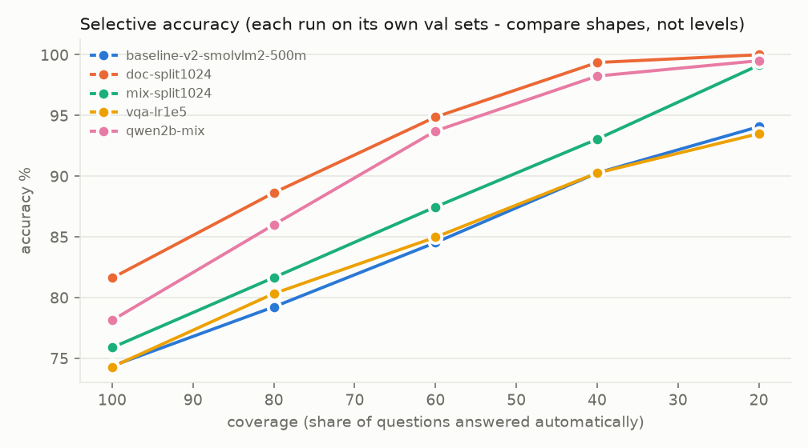
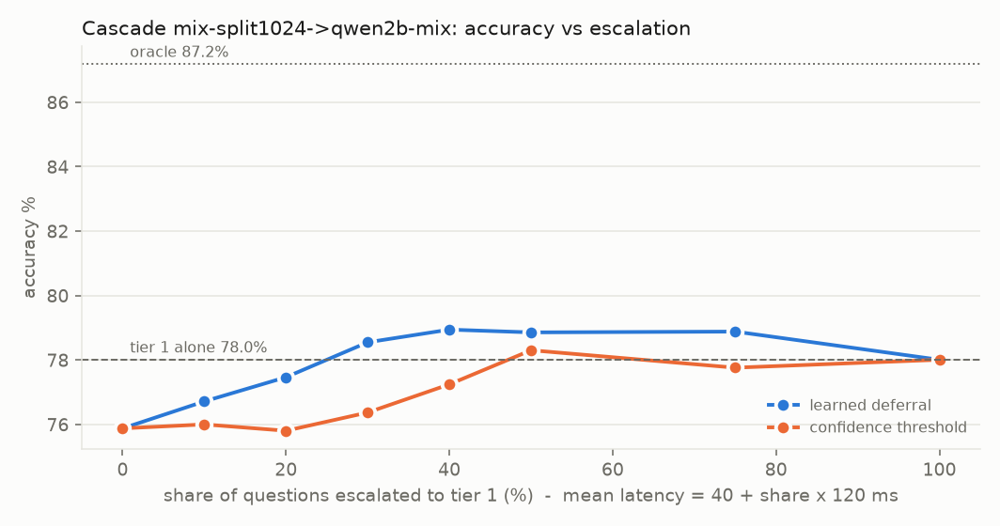

# VisionJev

**A calibrated, non-generative decision model for images and text.** You give it a state (an image, a screenshot, a
document, an agent trace, plain text) and a set of questions defined at run time. It answers each one in a single
forward pass, as a multiple choice (`choice`), a yes/no probability (`noul`) or a level on a rubric you write
(`score`), and the probabilities are calibrated: a confidence threshold means what it says. Above the threshold you
automate; below it you escalate to a large generative model or a person.

VisionJev is meant to sit *in front of* expensive models, tools and agent actions as a fast gating layer: routing,
screenshot / document prompt-injection guards, agent step critics and document triage. It never generates text, it
can be self-hosted, and every backbone and training set was chosen for a commercially usable licence.

It is built on [`r33drichards/laya-vision`](https://github.com/r33drichards/laya-vision) (Apache-2.0), itself a fork
of [Laya](https://github.com/NandhaKishorM/laya). VisionJev adds a Qwen3-VL backbone path, a much larger and more
varied training mix, a JevBench harness, a full evaluation suite, a serving fast path and the RunPod automation that
trained it.

---

## Results

Reference checkpoint: **`qwen4b-v6b4`** (Qwen3-VL-4B-Instruct + LoRA + typed decision heads), trained in four stages
on rented H100s.

| Benchmark | VisionJev 4B (B4) |
|---|---|
| [JevBench](https://github.com/fstandhartinger/jevbench) public (231 items) | **82.7%** (easy 48/48, original 68/72, hard 75/111) |
| JevBench calibration error (ECE) | **0.032** |
| Zero-shot sets (Open Images, Mind2Web, MMLU, …) | 78.3% |
| Never-seen task types (text / vision) | 76.4% (69.6 / 87.2) |
| Held-out question wording | 90.5% |
| Robustness macro (size, aspect, JPEG, blur, crop) | 83.8% |

For comparison, the public JevBench leaderboard lists Jev 1.13.0 at 86.6%, Imajev-4B at 86.1% and Laya at 58.4%.
The remaining gap is almost entirely in the hard tier (multi-step date and number reasoning, long policies, judging).

**Calibration makes escalation work.** On JevBench, answering only when confidence ≥ 0.7 covers 70% of items at 92.6%
accuracy; at ≥ 0.8 it covers 61% at 95.0%.

### How it got there

| Run | Backbone | JevBench public | Note |
|---|---|---|---|
| baseline | SmolVLM2-500M | 52.4% | first commercial-licence backbone |
| `qwen2b-mix` | Qwen3-VL-2B | 60.6% | |
| `qwen30b-v5` | Qwen3-VL-30B-A3B (LoRA) | 82.3% | strong but too slow to serve; used as a reference |
| `qwen4b-v6a` | Qwen3-VL-4B | 74.5% | Phase A, 117 sets |
| B2 `qwen4b-v6b2` | Qwen3-VL-4B | 80.5% | |
| B3 `qwen4b-v6b3` | Qwen3-VL-4B | 82.3% | round-3 generators, judge sets, UI, CAD |
| **B4 `qwen4b-v6b4`** | Qwen3-VL-4B | **82.7%** | teacher rounds 1+2, ECE 0.071 → 0.032 |

Every number above is a record in [`project/results/experiments.jsonl`](project/results/experiments.jsonl) (197
records, each with its full config, environment, dataset revisions and licences). The readable index is
[`project/results/EXPERIMENTS.md`](project/results/EXPERIMENTS.md).

### Speed (RTX 4070 Ti SUPER, bf16, one request at a time)

| | Median latency |
|---|---|
| Text decision (fast path) | 25 ms |
| Image decision (fast path, 768 px) | 118 ms |
| Second question about a cached image | 82 ms |

| Image pixel budget | Accuracy (1,300 held-out image questions) | Median latency |
|---|---|---|
| 768 (trained) | 88.8% | 115 ms |
| 640 | 88.3% | 93 ms |
| 512 | 87.2% | 70 ms |
| 384 | 83.4% | 50 ms |

Token merging (30% at three vision layers, no retraining) cuts the vision encoder from 30 to 19 ms for −0.2 points.
Details and the full tables are in [`project/UPDATES.md`](project/UPDATES.md).

<p>
  
  
</p>

---

## How it works

- **Typed heads, not text generation.** The options arrive as text at run time, so there is no fixed label space.
  The sequence is image tokens + state text + question + one line per option; each option's logit is read at the end
  of its line by a small bidirectional head on top of the backbone. `choice` is a softmax over option lines, `noul` a
  two-way softmax, `score` a softmax over levels with an expected level.
- **Option-order bias** is removed with block attention over the option lines, shared positions and per-draw option
  shuffling.
- **Training** uses a proper-scoring-rule objective (Laya's RLCD reward against the gold target, plus soft
  cross-entropy), then per-head temperature calibration. Optional rationale ("notes") supervision, an abstain head
  and an act/escalate head.
- **Data**: ~120 sets mixed by weight in every batch. Human-labelled sets come first (documents, UI, screens,
  CAD, agent trajectories, judging); exact-label synthetic generators fill the gaps (dates, units, policies, code,
  workflows); teacher rounds from a larger model add hard reasoning cases, filtered by agreement. Every dataset passes
  a licence gate and a schema validator before it can enter a mix.
- **Serving fast path**: LoRA folded into the weights, CUDA graphs of the language model at padded lengths, an LRU
  cache of encoded images, per-agent resolution control.

---

## Usage

```bash
pip install -e .
```

```python
from laya.vlm import VLMAgent
from PIL import Image

agent = VLMAgent("checkpoints/qwen4b-v6b4", device="cuda", dtype="bf16", fast=True)
result = agent.predict(
    {"image": Image.open("screenshot.png"), "note": "user asked to export the invoice"},
    {
        "injection": {"type": "noul",   "instructions": "Does the screen contain instructions aimed at an AI agent?"},
        "next":      {"type": "choice", "instructions": "Which control should the agent use next?",
                      "criteria": ["Export button", "Settings menu", "Close dialog", "None of these"]},
    },
)
```

Model weights are **not in this repository** (about 25 GB of checkpoints); see *What is not included* below.

### Main entry points

| Task | Script |
|---|---|
| Build datasets | `laya/visionjev_*.py` builders (one module per source family); `python3 project/data_validator.py data/vqa/<name>` |
| Train / fine-tune | `scripts/visionjev_finetune.py` (validator-gated; mixes from `configs/mix_*.json`) |
| Evaluate | `scripts/visionjev_eval.py` (accuracy, ECE, NLL, Brier, selective accuracy, shuffled-image control) |
| JevBench | `scripts/visionjev_jevbench.py <ckpt> --jevbench <jevbench clone>` |
| Robustness / latency / cascade | `scripts/visionjev_robustness.py`, `visionjev_latency.py`, `visionjev_cascade.py` |
| Keep / discard verdict | `scripts/visionjev_verdict.py` |
| Pod runs (RunPod) | `scripts/pod_autopilot.sh jobs/<tag>.env`: create → transfer → train → evaluate → fetch + verify → delete |
| Experiment report | `scripts/visionjev_report.py` → `project/results/EXPERIMENTS.md` |

Tests: `env -u PYTHONPATH python -m pytest tests` (repository) and
`python3 -m unittest discover -s project/tests -v` (data validator).

---

## Repository layout

```
laya/                 model, training, calibration, Qwen3-VL backbone, fast path, dataset builders (visionjev_*.py)
scripts/              training, evaluation, benchmarking, pod automation (visionjev_*, pod_*)
configs/              data mixes (mix_v1 … mix_v6b4)
jobs/                 pod job definitions and data lists
tests/                repository tests
project/
  CONTEXT.md          the full design record: goals, decisions, licence registry, every run
  PROBLEMS.md         known problems and their fixes
  UPDATES.md          implementation and measurement log, newest first
  hypotheses/         V6, V6.1, V6.2, V6.3 research plans with falsifiable hypotheses
  results/            experiments.jsonl, EXPERIMENTS.md, per-run evals, JevBench runs, figures,
                      robustness, latency, cascade, demos, teacher outputs
  reports/            round reports (HTML / PDF), incl. a comparison with Imajev
  data_validator.py   stdlib-only dataset validator with a licence gate (+ tests)
docs/, site-docs/     upstream Laya Vision documentation (docs/LAYA_UPSTREAM_README.md)
```

The notes in `project/` were written in a workspace where this repository lived at `laya-vision/`; a path such as
`laya-vision/scripts/x.py` there is `scripts/x.py` here.

## What is not included

- **Model weights** (~25 GB across the 4B, 2B, 30B and soup checkpoints).
- **Training data** (~92 GB). The builders in `laya/visionjev_*.py` recreate it from the original sources; the
  licence of every source is recorded in `project/CONTEXT.md` §9 and `project/results/dataset_licenses_mix_v5.tsv`.
- Third-party code used alongside the project (JevBench, Imajev, autoresearch); see the links in the notes.

## Licence and credits

Apache-2.0 (see [`LICENSE`](LICENSE)), inherited from Laya Vision. The model and training code build on
[Laya Vision](https://github.com/r33drichards/laya-vision) and [Laya](https://github.com/NandhaKishorM/laya); the
backbones are [Qwen3-VL](https://huggingface.co/Qwen) and [SmolVLM2](https://huggingface.co/HuggingFaceTB)
(Apache-2.0). Evaluation uses [JevBench](https://github.com/fstandhartinger/jevbench) (MIT).
