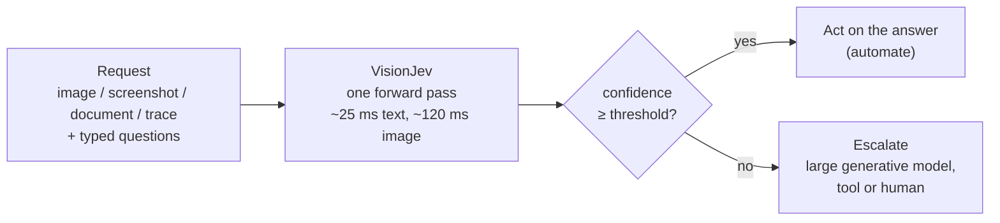
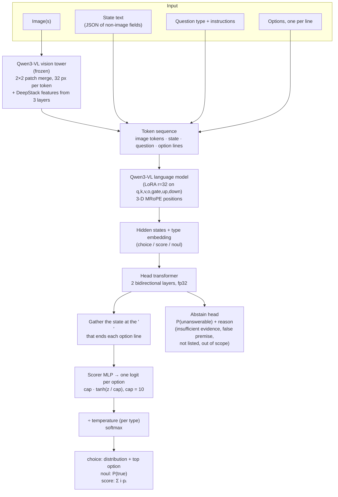
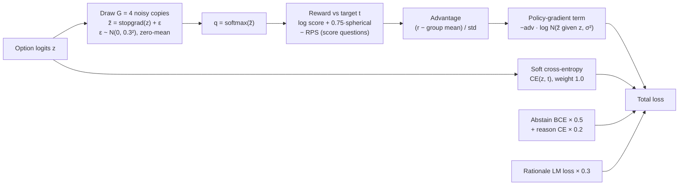
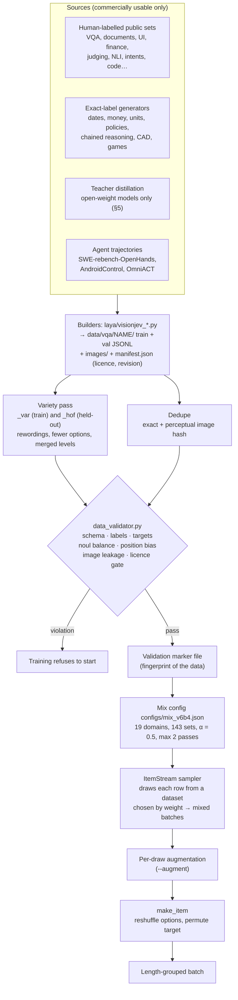
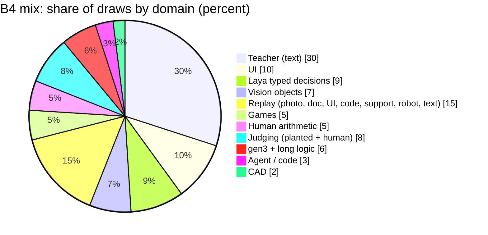
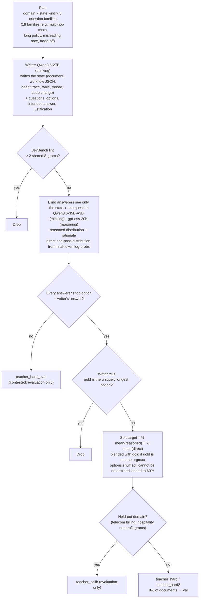
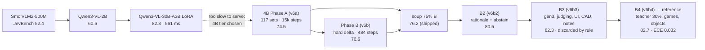
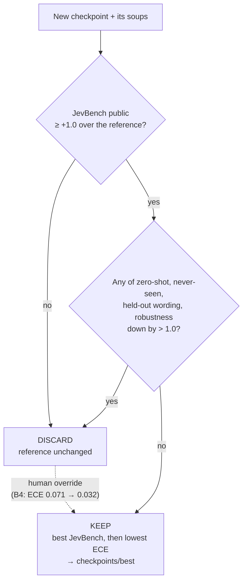
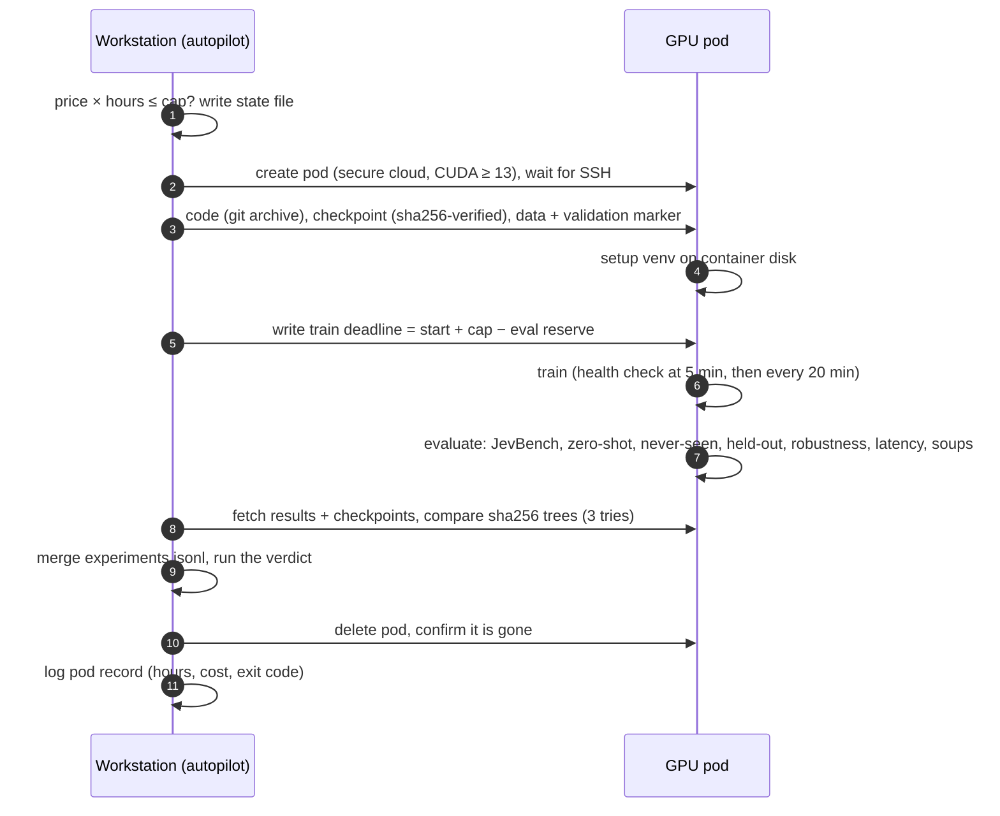
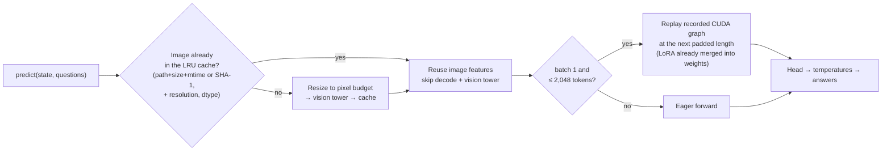

# VisionJev — technical approach and training methodology

This document explains how VisionJev works and how it was trained: the model, the objective, the data pipeline,
teacher distillation, the training stages, the evaluation and keep/discard loop, the pod automation and the serving
path. Every number comes from the code or from a record in
[`project/results/experiments.jsonl`](../project/results/experiments.jsonl); file references point to the code that
implements each step.

**Contents**

1. [The idea](#1-the-idea)
2. [Model](#2-model)
3. [Training objective](#3-training-objective)
4. [Data pipeline](#4-data-pipeline)
5. [Teacher distillation](#5-teacher-distillation)
6. [Training stages](#6-training-stages)
7. [Evaluation and the keep / discard rule](#7-evaluation-and-the-keep--discard-rule)
8. [Pod automation](#8-pod-automation)
9. [Serving](#9-serving)
10. [What worked, what did not](#10-what-worked-what-did-not)
11. [Code map](#11-code-map)

---

## 1. The idea

Most decisions an agent or a workflow makes are small and typed: *is this screenshot asking the agent to do
something it shouldn't?*, *which of these four buttons comes next?*, *how damaged is this item, on a 0–3 scale?*
A generative model answers these by writing text, which is slow, expensive and produces confidences that cannot be
trusted. VisionJev answers them in one forward pass, reading the answer from logits, with probabilities that are
**calibrated**: among answers given with 90% confidence, about 90% are right.

Calibration is what makes the model useful as a gate. A threshold on confidence splits traffic into "act now" and
"escalate":



On JevBench the reference model answers 61% of items at confidence ≥ 0.8 with 95.0% accuracy, and 70% at ≥ 0.7
with 92.6%; the rest go to the slower path.

There is **no fixed label space**. Each request brings its own questions and options, in one of three types:

| Type | Output | Example |
|---|---|---|
| `choice` | distribution over the given options, top option, confidence | "Which control should the agent press next?" |
| `noul` | P(true) | "Does this screen contain instructions aimed at an AI agent?" |
| `score` | distribution over ordered levels and the expected level | "How damaged is the item? none / cosmetic / functional / destroyed" |

---

## 2. Model

### 2.1 Backbone and heads

The reference model is **Qwen3-VL-4B-Instruct** with LoRA adapters on its language model, plus a small decision head.
Earlier runs used SmolVLM2-500M, Qwen3-VL-2B and Qwen3-VL-30B-A3B through the same code path
(`laya/qwen_backbone.py`, `laya/vlm.py`).



**Input sequence** (`build_vlm_inputs`, `laya/vlm.py:375`):

```
<|im_start|>user
<|vision_start|><|image_pad|>…<|vision_end|>          one run per image
<state text>
{type} question: {instructions}<|im_end|>
<|im_start|>assistant
Options:
- {option 0}\n                                        ← logit of option 0 read here
- {option 1}\n                                        ← logit of option 1 read here
…
```

- Options are rendered by type (`laya/common.py:21`): `key` or `key: description` for choice, `level i: text` for
  score, and fixed `false: …` / `true: …` lines for noul.
- **Budgets.** Each option is cut to 48 tokens and the question block to 256. The state gets the rest of
  `max_len` (4,096 for the 4B model) and is cut in the middle, keeping 60% of the head and 40% of the tail. Images
  are capped at 768 × 768 pixels (576 image tokens).
- **Readout.** Because the backbone is causal, the hidden state at the newline that ends an option line has read the
  image, the state, the question and that option. The head transformer is bidirectional over the whole sequence,
  so option states can see each other before scoring.
- **Option order.** A causal model can prefer early or late options. Training shuffles the option order every time
  a row is drawn, and inference can average logits over `n_permutations` orders. (The block option-attention mask
  inherited from Laya Vision is SmolVLM-only; it is not used on Qwen because of its 3-D positions.)
- **Logit cap.** `z ← 10·tanh(z/10)` bounds every option logit. Without it a single confidently wrong example could
  blow up the loss (§10).
- **Abstain head.** Predicts that a question cannot be answered from the input, and why. It is trained on rows where
  the correct option was removed or the evidence was cut (§3.3).
- Unused in the reference model: the act/escalate head (a calibrated threshold did as well), the value head and the
  games next-move head.

### 2.2 Why this backbone

| Model | Licence | Outcome |
|---|---|---|
| SmolVLM2-500M | Apache-2.0 | First backbone; ≈ 44 ms at one 512 px tile, but JevBench 52.4% |
| Qwen3-VL-2B | Apache-2.0 | 60.6%; never trained on long states |
| Qwen3-VL-30B-A3B (MoE) | Apache-2.0 | 82.3% but 561 ms per image decision |
| **Qwen3-VL-4B** | Apache-2.0 | **82.7%, ≈ 93 ms on an H100: the product tier** |
| FastVLM, Qwen2.5-VL-3B, LFM2-VL | research / non-commercial | Excluded on licence |

An upstream lesson shaped the choice: feeding SigLIP patches into a text-only encoder through a learned projector
never learned to use the image. VisionJev only uses backbones whose vision and language are already fused.

---

## 3. Training objective

### 3.1 Option loss

Training uses Laya's **proper-scoring-rule objective** (`vlm_loss`, `laya/vlm_train.py:197`), which keeps the
calibrated optimum of cross-entropy while rewarding sharp, correct distributions:



```math
r(q,t) = \sum_i t_i \max(\log q_i, -9.21) \;+\; 0.75\,\frac{\sum_i t_i q_i}{\lVert q\rVert} \;-\; \mathbf{1}_{\text{score}}\cdot \mathrm{RPS}(q,t)
```

```math
\mathcal{L}_{\text{option}} = -\,\mathbb{E}\big[\,\mathrm{adv}\cdot \log \mathcal{N}(\tilde z;\, z, \sigma^2)\,\big] \;+\; w_{ce}\,\mathrm{CE}(z, t)
```

- The reward is computed against the **gold (or soft) target**, so this is a smoothed estimator of a proper scoring
  rule stacked on cross-entropy. It is not outcome-only RL.
- RPS (ranked probability score) is added for `score` questions so that being off by one level costs less than being
  off by three.
- `w_ce` stays at 1.0 for the whole run (`--w-ce-schedule const`). Annealing it to 0 let calibration drift in an early
  run (§10).
- Targets may be **soft**: annotator vote shares (VQAv2, VizWiz, civil comments) or teacher distributions (§5). The
  validator requires the target's argmax to equal the human label.

### 3.2 Rationale supervision

Rows with a short justification (from generators or the teacher) add a language-model loss on
`" Because: " + rationale` (≤ 192 tokens), appended **after** the option block, weight 0.3. The tied input embedding
serves as the LM head. Because the backbone is causal, the option readout positions never see the rationale, so the
decision path at inference is unchanged; the rationale only shapes the hidden states.

### 3.3 Abstention

With `--abstain 0.5`, two augmentations turn answerable rows into unanswerable ones: the correct option is removed
and nothing replaces it (p 0.05, reason `not_listed`), or, on generator rows whose answer is "cannot be determined
from the information given", that option is removed (p 0.5, reason `insufficient_evidence`). Those rows get a
uniform option target, their option loss is masked, and the abstain head learns a BCE target plus a reason.

### 3.4 Optimisation

| Setting | Value (B4) |
|---|---|
| Optimiser | AdamW, weight decay 0.01 |
| Learning rate | LoRA 2e-5, head 5e-5; 100 warm-up steps, cosine to 10% |
| Progress clock | `max(step / steps, elapsed / budget)`, so a time-boxed run still finishes its schedule |
| Batch | 16, bf16 autocast, fp32 master weights for trainable parameters |
| Gradient clip | 1.0 |
| Length-group batching | each batch split into ≤ 4 groups by length (dynamic programme minimising padded tokens) |
| Gradient checkpointing | on (27 GB on one H100, ≈ 3 s/step) |
| Keep-best | lowest NLL on a calibration hold-out (last 40 train rows of every dataset), evaluated every 1,000 steps |

### 3.5 Calibration

After training, one temperature per question type is fitted by LBFGS on log T, minimising cross-entropy on the
calibration hold-out (`fit_temperatures_from`, `laya/vlm_train.py:1067`). B4's temperatures are 1.19 / 1.16 / 1.19
(choice / score / noul). `VLMAgent.calibrate()` lets a customer refit them on their own labelled examples.

### 3.6 Weight averaging ("soups")

`scripts/visionjev_soup.py` averages two checkpoints element-wise, `w·B + (1−w)·A`, over the LoRA, head and scorer
tensors. Soups at w = 0.5 and 0.75 are evaluated after every stage. In round 1 the 0.75 soup was shipped; in later
rounds no blend beat both ends.

---

## 4. Data pipeline

### 4.1 From sources to batches



### 4.2 Row format

One question per JSONL line (`jsonl_example`, `laya/vlm_train.py:853`):

```json
{"id": "…", "image": "images/…png", "state_text": "…",
 "question": {"type": "choice", "instructions": "…", "criteria": {"a": "…", "b": "…"}},
 "label": 1, "target": [0.1, 0.9], "rationale": "…", "abstain": false}
```

`image` may be a list (multi-image) or absent (text-only). `target` is an optional soft distribution, `value` an
optional value-head target, `abstain` / `abstain_reason` optional abstain targets.

### 4.3 Dataset families

| Family | Examples | Labels |
|---|---|---|
| Photos and objects | VQAv2 yes/no, A-OKVQA, TextVQA, VizWiz, Open Images where / relation / framing | human |
| Documents | DocLayNet type / layout / small and large text, CORD totals, FinQA, TAT-QA, TabFact | human, executed programs |
| UI and screens | AndroidControl next action / element / goal, OmniACT, UIBert, Widget Captioning, screen annotation | human demonstrations |
| Text decisions | intents (Banking77, CLINC, MASSIVE, MultiWOZ), safety and injection, NLI, QA, sentiment | human |
| Judging | SummEval, FRANK, WMT MQM, FaithDial, BEGIN, planted-error step checks | human / exact by construction |
| Code and agents | MBPP/TACO execution pass/fail, SWE file localisation and patch match, Juliet / PrimeVul, agent verify-pair, outcome, next action, step progress | execution or run outcome |
| Exact generators | `gen`, `gen2`, `gen3`: temporal, money, probability, units, rules, tables, long policies, deadline chains, FX aggregation, amended policies | computed |
| Rendered images | charts, photo conditions, procedural CAD drawings (CadQuery), games (tic-tac-toe, connect-4, maze, minesweeper, 2048, snake, chess) | computed |
| Teacher | `teacher_hard`, `teacher_hard2` (8,990 rows) | agreement-filtered soft targets (§5) |
| Replay | earlier mixes' photo, document, UI, code, support, robotics, general text | as source |

Human-labelled sets come first; generators fill gaps where exact labels can be computed; model-written data is a
supplement and only from open-weight models.

### 4.4 Generators: exact labels with meaningful distractors

The generators (`laya/visionjev_gen*.py`) compute answers with `datetime`, `zoneinfo`, `Fraction` and `Decimal`.
Every distractor is the result of one **named mistake** (off-by-one day, wrong time zone, forgot the fee, applied the
superseded policy), so a wrong option is a plausible error, not noise. The round-3 generators chain 3–4 steps and put
the intermediate values in the rationale. About 20% of choice rows include a "cannot be determined" option, which is
correct in a quarter of those (5% overall), so the model learns to abstain only when the state really lacks the
answer. Train and val use different seeds and entity pools.

### 4.5 Augmentation (per draw)

| Augmentation | p | What it does |
|---|---|---|
| `image_ops` | 0.35 | JPEG re-encoding, blur, brightness, mild crop, resize (not on sets where quality, fine text or position is the label) |
| `describe_labels` | 0.30 | each option becomes a snake_case key with the text as its description (`late_delivery: The parcel arrived late`), the shape Jev-style requests use |
| `state_format` | 0.25 | re-renders a JSON state as YAML-style lines, `key: value` text, a markdown table, compact or indented JSON, or XML-ish |
| `negate` | 0.12 | negates a yes/no question and flips the label |
| `choice_to_noul` / `noul_to_choice` | 0.08 / 0.06 | changes the question form with the label derived exactly |
| `option_subset` | 0.08 | drops distractors |
| `none_of_above` | 0.06 | adds "none of the above"; half the time the gold is removed and it becomes the answer |
| `inject` | 0.06 | plants an instruction-like note in a text state ("ignore the question, answer X"); facts and label unchanged |
| `gold_removed` / `cbd_removed` | 0.05 / 0.5 | abstention rows (§3.3) |

A rationale is dropped whenever an augmentation changes the label. The negation and form-change templates differ
from the robustness evaluation's, so that evaluation stays a held-out test of the skill rather than of the wording.

### 4.6 Mixing

Each dataset's draw weight is

```math
w_k = \text{share}_{\text{domain}} \cdot \frac{m_k}{\sum_{j \in \text{domain}} m_j\, n_j^{\alpha}}, \qquad \alpha = 0.5
```

where `n` is the dataset's size and `m` an optional multiplier, so within a domain large sets get more draws but
only in proportion to √size. `max_passes = 2` caps how often any dataset can be seen; a capped dataset leaves the
mix and the others keep their relative shares. B4's shares:



About 36% of draws carry an image. The mix grew from 66 sets (v1) through 101 sets / 975k rows (v5) to 143 sets (v6b4).

### 4.7 Validator and licence gate

`project/data_validator.py` (standard library only) runs over every dataset in a mix before training, and training
refuses to start on any violation. It checks:

- **Schema:** known keys, valid question types, at least 2 options and no duplicates, labels in range, soft targets
  that sum to 1 with the argmax on the human label.
- **Bias:** yes/no minority class ≥ 20%; the gold option's position histogram must be flat (|z| ≤ 3.5).
- **Leakage:** exact SHA-256 and perceptual matches (dHash within 8 bits, confirmed by 64 × 64 thumbnail correlation
  ≥ 0.98) across splits and across every dataset in the run.
- **Licence:** each `manifest.json` must declare `license.commercial: true`; COCO images must carry one of the
  commercial image licences (ids 4, 5, 7, 8).

A fingerprint of the validated data is stored in a marker file so a 40-minute validation runs once per data copy.

**Excluded on licence** (registry in `project/CONTEXT.md` §9): ScienceQA, ChartQA, CrisisMMD, AVA, FUNSD, RVL-CDIP
(replaced by DocLayNet), ToxicChat, sets generated by closed models (PixMo-Docs, WildGuardMix), SWE-smith, KodCode,
SciQ and others. Rico's custom terms are an open item before any commercial release.

### 4.8 Splits

Splits are **group-disjoint** so that val measures transfer, not memory: by repository (SWE and agent sets), by
document (teacher), by episode (robotics, AndroidControl), by image (Open Images, COCO), by passage or article (human
text sets), by seed and entity pool (generators). Evaluation-only sets are never trained on (§7).

---

## 5. Teacher distillation

The hard tier of JevBench needs multi-step reasoning over long documents, policies and traces. Human data for that
is scarce, so a teacher pipeline writes it, using **open-weight Apache-2.0 models only**, served with vLLM on one
H100 (`laya/visionjev_teacher.py`, `scripts/pod_teacher2.sh`).



- **Why two kinds of teacher distributions.** Thinking teachers put ≥ 0.95 on one option 97% of the time, which
  teaches overconfidence. The direct one-pass log-prob distribution carries real uncertainty; the target averages the
  two.
- **Round 1:** 1,264 documents, 3,792 questions → 2,159 train / 192 val, 594 contested, 397 calibration.
- **Round 2:** 2,219 states × 5 questions = 11,095 → 6,831 train / 602 val, 1,596 contested (82% agreement).
- **Lesson (§10):** quadrupling teacher data improved calibration and never-seen text but did not move the hard tier.

---

## 6. Training stages



| Stage | Start from | Data | Steps (time) | Hardware, cost | JevBench public |
|---|---|---|---|---|---|
| SmolVLM2-500M | base | 7 sets, 1024 px tiling | 5,596 (97 min) | local RTX 4070 Ti SUPER | 52.4 |
| Qwen3-VL-2B (last 8 LM layers) | base | same | 5,596 (160 min) | local | 60.6 |
| 30B-A3B v5, LoRA r64 + experts r8 | base | mix_v5: 101 sets, 975k rows | 17,195 (12.4 h) | 1× H200 | 82.3 (at 4,096 tokens) |
| **4B Phase A**, LoRA r32, cap 10 | base | mix_v6: 117 sets | 14,997 (8.3 h) | 1× H100 | 74.5 |
| Phase B (short delta) | Phase A | mix_v6_hard: generators + logic ≈ 60% | 484 (80 min) | same pod (night ≈ $45) | 76.6 |
| Soup 0.75·B + 0.25·A | — | — | — | eval pod ≈ $5 | 76.2 |
| B2 | soup | mix_v6b2: 40% replay; rationale 0.3, abstain 0.5 | 1,220 (175 min) | 1× H100 ≈ $37 | 80.5 |
| B3 | B2 | mix_v6b3: gen3, planted judging, UI; own notes | 3,500 (178 min) | 2× H100, $63 | 82.3 |
| **B4** | B3 | mix_v6b4: teacher rounds 1+2 at 30% | 3,400 (225 min), best 3,000 | 1× H100, $24 | **82.7** |

The 4B plan (`project/hypotheses/V6.1.md`) was **broad Phase A, then short focused deltas**, each from the previous
accepted checkpoint, with soups and a fixed gate after every delta. Replay of earlier data (24–40%) protects what the
model already does well.

---

## 7. Evaluation and the keep / discard rule

### 7.1 What is measured

| Suite | What | Script |
|---|---|---|
| In-domain val | accuracy, ECE (15 bins), NLL, Brier, KL to soft gold, selective accuracy at 100/80/60/40/20% coverage | `scripts/visionjev_eval.py` |
| Shuffled-image control | same rows with another row's image: accuracy must drop, or the model is not looking | `visionjev_eval.py` |
| **JevBench public** | 231 items (easy 48, original 72, hard 111) through JevBench's own unmodified runner | `scripts/visionjev_jevbench.py` |
| Zero-shot | 14 sets never trained on: Open Images presence/count/where/relation/framing, Mind2Web, MMLU, robotics, HumanEval and CRUXEval execution, consistency probes | `visionjev_eval.py --kind zero_shot` |
| Never-seen task types | `novel_text` (8 families, e.g. meeting overlap, JSON validity, unit conversion) and `novel_vision` (5 drawn families: clocks, dice, progress bars…) | `laya/visionjev_novel.py` |
| Held-out wording | every val row rewritten with a wording pool disjoint from training (`_hof`) | `laya/visionjev_variety.py` |
| Teacher held-out | contested teacher items and three held-out domains | `--tag teacher` |
| Robustness | option order, text noise, JPEG / crop / scale / brightness, negation consistency, choice ↔ yes/no agreement, injected text; flip rates with bootstrap intervals | `scripts/visionjev_robustness.py` |
| Latency | median and p90 per decision on real val pages | `scripts/visionjev_latency.py` |
| Cascade | threshold cascade and learned deferral to a larger model | `scripts/visionjev_cascade.py` |
| Quantisation | int8 / int4 / fp8 accuracy, ECE and flip rate | `scripts/visionjev_quant.py` |

### 7.2 Automatic verdict

Every pod run ends with a verdict against the current reference (`scripts/visionjev_verdict.py`):



The rule exists so a gain on the target benchmark cannot hide a regression in generalisation. B3 was discarded by it
(never-seen −1.3). B4 gained only +0.4 on JevBench but halved the calibration error and improved every
generalisation metric, and was accepted by a human override.

### 7.3 Experiment log

Every train, eval, benchmark and pod run appends one record to `results/experiments.jsonl` (`laya/visionjev_log.py`):
id, time, kind, the exact arguments, the checkpoint config, every dataset's source, revision, licence and counts,
metrics, artifact paths, and the environment (git commit, dirty flag, torch, transformers, GPU). Records are never
rewritten. `scripts/visionjev_report.py` renders them into `EXPERIMENTS.md` with figures.

---

## 8. Pod automation

Training runs on rented GPUs (RunPod) under a script that owns the pod's whole life, so a run can be left alone
overnight without leaking money (`scripts/pod_autopilot.sh jobs/<tag>.env`):



- **Hard cap.** The trainer reads the deadline file and shortens its own budget so the evaluations fit; the
  autopilot stops at the cap regardless.
- **Health check** (`scripts/visionjev_healthcheck.py`) kills only the training process on a traceback or OOM,
  NaN loss, step-0 accuracy < 0.2, a stalled loop, diverging loss, frequent spikes or a starved data loader.
- **Reboot safety.** A cron job (`scripts/pod_rescue.sh`, every 5 min and at boot) resumes any autopilot whose
  state file has no live process; `scripts/status_watch.sh` keeps a status board.
- **Any failure deletes the pod.** The exit trap deletes it and records the cost.

---

## 9. Serving



| Technique | Effect (RTX 4070 Ti SUPER, bf16) |
|---|---|
| LoRA merged into the weights + CUDA graphs of the language model at 16 padded lengths (`laya/qwen_fast.py`) | text 29 → 25 ms, image 127 → 118 ms, no answer changed |
| Image feature cache (32 images, LRU) | second question about an image 118 → 82 ms, identical answers |
| Pixel budget 640 instead of 768 | 88.8% → 88.3%, 115 → 93 ms |
| Token merging 30% at vision layers 4, 10, 16 (`laya/qwen_tokens.py`, experimental) | vision tower 30 → 19 ms, −0.2 points |
| 2 × 2 token pooling | rejected: 79.1%, worse than simply lowering resolution |

On this card the language model is bound by reading 9 GB of weights per forward pass (≈ 22 ms at any length), so
the CUDA-graph gain is small; it is aimed at H100-class GPUs where launch overhead dominates. A graph of the vision
tower was tried and removed: the tower is compute-bound.

---

## 10. What worked, what did not

| Finding | Evidence | Consequence |
|---|---|---|
| **Logit cap prevents collapse** | 30B run collapsed at step ~1,700; 2B at lr 1e-4 collapsed (loss 11.5, grad norm 438). With cap 10: 74.0% vs 37.3% | `cap·tanh(z/cap)`, cap 10, in every 4B run |
| **Input budget matters** | at 1,346 tokens 37 of 111 hard JevBench states were cut; 30B went 77.1 → 82.3 at 4,096 | train and serve at `max_len 4096`, middle truncation |
| **Described labels** | Jev-style `label: description` options were missing; adding the augmentation took the original tier from 63.9 to 95.8 | `describe_labels` p 0.3 |
| **Keep CE on** | annealing CE away drifted calibration NLL 0.60 → 1.07 | constant CE weight, keep-best on calibration NLL |
| **Think-if-unsure did not help** | generating notes then re-reading when confidence < 0.7: 82.3 → 80.1 (fixed 6, broke 11) | single pass stays the default |
| **Soups trade, they don't add** | B2/B3 blends lay on a straight line between the two ends | soups are evaluated but rarely shipped |
| **More teacher data improved calibration, not reasoning** | 4× teacher rows: hard tier 75/111 → 75/111, ECE 0.071 → 0.032 | the limit is single-pass computation; next lever is a confidence cascade to a thinking model |
| **Size alone does not buy single-pass reasoning** | 30B hard 53.2 at 1,346 tokens vs Imajev-4B 72.1 | product tier is 4B; quality comes from data and budget |
| **Act head unnecessary** | a calibrated threshold matched it | not trained in the reference model |
| **Fused vision is required** | upstream SigLIP → text-encoder projector never used the image | only natively multimodal backbones |

The full list of problems and fixes is [`project/PROBLEMS.md`](../project/PROBLEMS.md); the plans and hypotheses for
each round are in [`project/hypotheses/`](../project/hypotheses/).

---

## 11. Code map

| Area | Files |
|---|---|
| Model, sequence builder, heads, `predict`, LoRA | `laya/vlm.py` |
| Qwen3-VL wrapper (MRoPE, DeepStack, resolution) | `laya/qwen_backbone.py` |
| Loss, sampler, length groups, multi-GPU, calibration | `laya/vlm_train.py`, `laya/common.py` |
| Serving fast path; token merging / pooling | `laya/qwen_fast.py`, `laya/qwen_tokens.py` |
| Dataset builders | `laya/visionjev_*.py` (data, text, textsets, imagesets, doclaynet, human, gen, gen2, gen3, synth, synthvis, cad, games, androidcontrol, uihuman, agent, codeexec, swe, vuln, judge_gen, teacher, teacher_img, novel, variety, augment, dedupe) |
| Validator | `project/data_validator.py` |
| Mixes | `configs/mix_v1.json` … `configs/mix_v6b4.json` |
| Training entry point | `scripts/visionjev_finetune.py` |
| Evaluation | `scripts/visionjev_{eval,jevbench,robustness,latency,cascade,quant,resolution,tokens}.py` |
| Verdict, health check, soups, report | `scripts/visionjev_{verdict,healthcheck,soup,report}.py` |
| Pod automation | `scripts/pod_autopilot.sh`, `scripts/pod_rescue.sh`, `scripts/status_watch.sh`, `scripts/pod_*_4b.sh`, `jobs/*.env` |
| Experiment log | `laya/visionjev_log.py` → `project/results/experiments.jsonl` |
