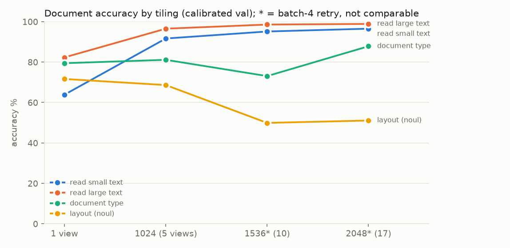
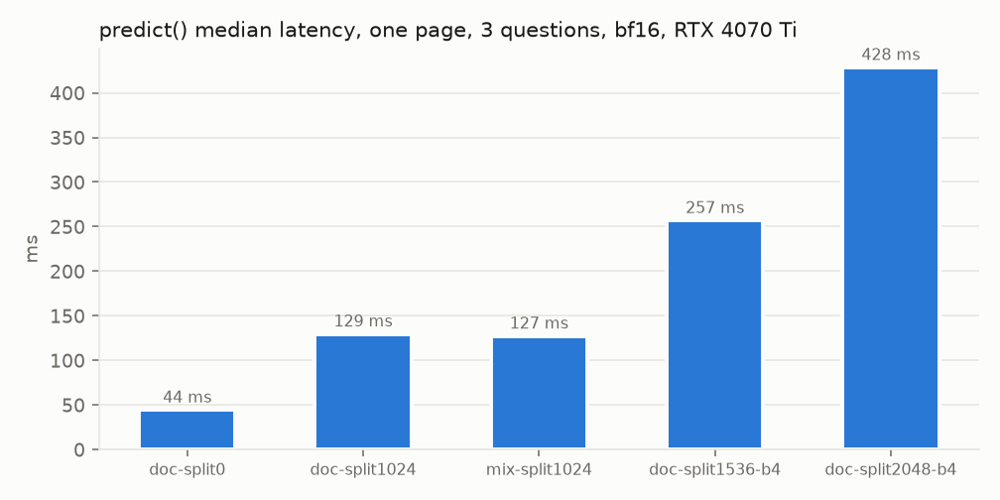

# VisionJev experiments

Generated from `results/experiments.jsonl` (32 records) by `laya-vision/scripts/visionjev_report.py`. Every record keeps its full config, environment, dataset revisions/licenses and artifacts in the JSONL.

## Figures


| escalated | threshold acc | learned-deferral acc | mean ms |
|---|---|---|---|
| 0% | 75.9% | 75.9% | 40 |
| 10% | 76.0% | 76.7% | 52 |
| 20% | 75.8% | 77.5% | 64 |
| 30% | 76.4% | 78.5% | 76 |
| 40% | 77.2% | 78.9% | 88 |
| 50% | 78.3% | 78.9% | 100 |
| 75% | 77.8% | 78.9% | 130 |
| 100% | 78.0% | 78.0% | 160 |



| tiling | read small text | read large text | document type | layout (noul) |
|---|---|---|---|---|
| 1 view | 63.9% | 82.3% | 79.4% | 71.6% |
| 1024 (5 views) | 91.7% | 96.5% | 81.1% | 68.6% |
| 1536* (10) | 95.1% | 98.6% | 73.1% | 49.9% |
| 2048* (17) | 96.5% | 98.9% | 87.8% | 51.1% |



| checkpoint | median ms | p90 ms |
|---|---|---|
| doc-split0 | 44.0 | 46.8 |
| doc-split1024 | 129.3 | 134.3 |
| mix-split1024 | 127.0 | 131.1 |
| doc-split1536-b4 | 256.5 | 259.0 |
| doc-split2048-b4 | 428.3 | 429.8 |


| run | cov 100% | cov 80% | cov 60% | cov 40% | cov 20% |
|---|---|---|---|---|---|
| baseline-v2-smolvlm2-500m | 74.4% | 79.2% | 84.5% | 90.3% | 94.1% |
| doc-split1024 | 81.6% | 88.6% | 94.9% | 99.4% | 100.0% |
| mix-split1024 | 75.9% | 81.6% | 87.5% | 93.0% | 99.1% |
| vqa-lr1e5 | 74.3% | 80.3% | 85.0% | 90.3% | 93.5% |
| qwen2b-mix | 78.1% | 86.0% | 93.7% | 98.2% | 99.5% |

## Index

| id | time | kind | name | headline | git |
|---|---|---|---|---|---|
| 20260925-125808-2c99c7 | 2026-09-25T12:58 | train | baseline-v2-smolvlm2-500m | acc 74.4%, ECE 0.035 (n=2617) | cda49a3+dirty |
| 20260925-125808-1d101a | 2026-09-25T12:58 | train | doc-split0 | acc 77.0%, ECE 0.058 (n=3507) | cda49a3+dirty |
| 20260925-125808-c98344 | 2026-09-25T12:58 | train | doc-split1024 | acc 81.6%, ECE 0.056 (n=3507) | cda49a3+dirty |
| 20260925-125808-d56adf | 2026-09-25T12:58 | train | doc-split1536-b4 | acc 73.2%, ECE 0.058 (n=3507) | cda49a3+dirty |
| 20260925-125808-d2625a | 2026-09-25T12:58 | train | doc-split2048-b4 | acc 78.8%, ECE 0.025 (n=3507) | cda49a3+dirty |
| 20260925-125808-3d303e | 2026-09-25T12:58 | train | mix-split1024 | acc 75.9%, ECE 0.063 (n=8124) | cda49a3+dirty |
| 20260925-125808-71c77f | 2026-09-25T12:58 | train | vqa-act | acc 73.0%, ECE 0.040 (n=2617) | cda49a3+dirty |
| 20260925-125808-ae1d5a | 2026-09-25T12:58 | train | vqa-lr1e5 | acc 74.3%, ECE 0.036 (n=2617) | cda49a3+dirty |
| 20260925-125808-421f40 | 2026-09-25T12:58 | latency | overnight-latency-docs |  | cda49a3+dirty |
| 20260925-125808-75d8bd | 2026-09-25T12:58 | latency | overnight-latency-photos |  | cda49a3+dirty |
| 20260925-125808-81eeab | 2026-09-25T12:58 | latency | prefix-cache-on-vs-off |  | cda49a3+dirty |
| 20260925-125808-fd48f0 | 2026-09-25T12:58 | benchmark | laya-vision-vs-ours-on-our-val |  | cda49a3+dirty |
| 20260925-125808-e6e21c | 2026-09-25T12:58 | benchmark | typed-decisions-leaderboard |  | cda49a3+dirty |
| 20260925-130320-a0a9cd | 2026-09-25T13:03 | validate | openimages-vs-coco-train |  | cda49a3+dirty |
| 20260925-130356-21bf69 | 2026-09-25T13:03 | validate | mind2web |  | 2fc05d2+dirty |
| 20260925-134413-6992af | 2026-09-25T13:44 | reference | qwen3-vl-published-by-size |  | 7214f0e |
| 20260925-145915-b68314 | 2026-09-25T14:59 | validate | new-sets-24 |  | 23dfebb+dirty |
| 20260925-150248-d45322 | 2026-09-25T15:02 | train | qwen2b-mix | acc 78.1%, ECE 0.029 (n=8124) | f0926d8 |
| 20260925-151211-07ae99 | 2026-09-25T15:12 | zero_shot | zeroshot-oi-m2w:qwen2b-mix | acc 66.1%, ECE 0.083 (n=6214) | f0926d8 |
| 20260925-151540-3971d2 | 2026-09-25T15:15 | zero_shot | zeroshot-oi-m2w:mix-split1024 | acc 61.5%, ECE 0.073 (n=6214) | f0926d8 |
| 20260925-152638-951397 | 2026-09-25T15:26 | cascade | mix-split1024->qwen2b-mix |  | f0926d8 |
| 20260925-170005-7631e8 | 2026-09-25T17:00 | audit | label-and-shortcut-audit |  | 7fab6bb+dirty |
| 20260925-170246-b7c5e0 | 2026-09-25T17:02 | audit | label-and-shortcut-audit |  | 7fab6bb+dirty |
| 20260925-170352-742e14 | 2026-09-25T17:03 | note | data-fixes-from-audit |  | 7fab6bb+dirty |
| 20260925-175250-00e10c | 2026-09-25T17:52 | audit | label-and-shortcut-audit |  | d5250a4+dirty |
| 20260925-175551-5d8728 | 2026-09-25T17:55 | validate | all-new-and-changed-sets |  | d5250a4+dirty |
| 20260925-194130-a9d843 | 2026-09-25T19:41 | validate | vulnerability-sets |  | 1d5b69f+dirty |
| 20260926-004802-58cd71 | 2026-09-26T00:48 | train | qwen30b-a3b-smoke | acc 72.0%, ECE 0.027 (n=1536) | da8d7af |
| 20260926-005013-3b075c | 2026-09-26T00:50 | smoke | smoke-reload-check:qwen30b-a3b-smoke | acc 76.6%, ECE 0.105 (n=128) | da8d7af |
| 20260926-102312-177465 | 2026-09-26T10:23 | train | qwen30b-a3b-mix | acc 88.9%, ECE 0.024 (n=38642) | da8d7af |
| 20260926-103809-e3f8c4 | 2026-09-26T10:38 | zero_shot | zeroshot:qwen30b-a3b-mix | acc 68.6%, ECE 0.064 (n=7216) | da8d7af |
| 20260926-111016-bc1e13 | 2026-09-26T11:10 | heldout_formulation | hof:qwen30b-a3b-mix | acc 90.7%, ECE 0.031 (n=19708) | da8d7af |

## Records

### 20260925-125808-2c99c7 — train / baseline-v2-smolvlm2-500m

- time: 2026-09-25T12:58:08-0400; notes: BACKFILLED 2026-09-25 from files written at run time; env/git reflect the backfill, not the run
- checkpoint: /home/kneepolean/shubhj/VisionJev/checkpoints/baseline-v2-smolvlm2-500m
- datasets: aokvqa, vqav2_yesno
- artifacts: /home/kneepolean/shubhj/VisionJev/checkpoints/baseline-v2-smolvlm2-500m/metrics.json

| dataset | n | acc | ECE |
|---|---|---|---|
| all | 2617 | 74.4% | 0.035 |
| aokvqa | 322 | 69.6% | 0.090 |
| vqav2_yesno | 2295 | 75.0% | 0.036 |

<details><summary>config</summary>

```json
{
 "datasets": "aokvqa,vqav2_yesno",
 "root": "/home/kneepolean/shubhj/VisionJev/data/vqa",
 "out": "/home/kneepolean/shubhj/VisionJev/checkpoints",
 "run_name": "baseline-v2-smolvlm2-500m",
 "backbone": "HuggingFaceTB/SmolVLM2-500M-Video-Instruct",
 "minutes": 25.0,
 "steps": 1000000000,
 "batch_size": 16,
 "freeze": "full",
 "n_last": 8,
 "lr_head": 0.0001,
 "lr_backbone": 2e-05,
 "option_attention": "block",
 "w_ce_schedule": "anneal",
 "max_passes": 2.0,
 "mix_alpha": 1.0,
 "no_keep_best": false,
 "n_calib": 300,
 "max_train": 0,
 "max_val": 0,
 "eval_every": 300,
 "num_workers": 8,
 "allow_noncommercial": false
}
```
</details>

### 20260925-125808-1d101a — train / doc-split0

- time: 2026-09-25T12:58:08-0400; notes: BACKFILLED 2026-09-25 from files written at run time; env/git reflect the backfill, not the run
- checkpoint: /home/kneepolean/shubhj/VisionJev/checkpoints/doc-split0
- datasets: doclaynet_type, doclaynet_layout, doclaynet_read_small, doclaynet_read_large
- artifacts: /home/kneepolean/shubhj/VisionJev/checkpoints/doc-split0/metrics.json

| dataset | n | acc | ECE |
|---|---|---|---|
| all | 3507 | 77.0% | 0.058 |
| doclaynet_type | 1192 | 79.4% | 0.126 |
| doclaynet_layout | 1192 | 71.6% | 0.038 |
| doclaynet_read_small | 144 | 63.9% | 0.124 |
| doclaynet_read_large | 979 | 82.3% | 0.054 |

<details><summary>config</summary>

```json
{
 "datasets": "doclaynet_type,doclaynet_layout,doclaynet_read_small,doclaynet_read_large",
 "root": "/home/kneepolean/shubhj/VisionJev/data/vqa",
 "out": "/home/kneepolean/shubhj/VisionJev/checkpoints",
 "run_name": "doc-split0",
 "backbone": "HuggingFaceTB/SmolVLM2-500M-Video-Instruct",
 "minutes": 60.0,
 "steps": 1000000000,
 "batch_size": 8,
 "freeze": "full",
 "n_last": 8,
 "lr_head": 0.0001,
 "lr_backbone": 2e-05,
 "option_attention": "block",
 "w_ce_schedule": "anneal",
 "max_passes": 1.0,
 "mix_alpha": 1.0,
 "image_split_edge": 0,
 "grad_checkpointing": false,
 "train_act": true,
 "no_keep_best": false,
 "n_calib": 200,
 "max_train": 0,
 "max_val": 0,
 "eval_every": 500,
 "num_workers": 4,
 "allow_noncommercial": false
}
```
</details>

### 20260925-125808-c98344 — train / doc-split1024

- time: 2026-09-25T12:58:08-0400; notes: BACKFILLED 2026-09-25 from files written at run time; env/git reflect the backfill, not the run
- checkpoint: /home/kneepolean/shubhj/VisionJev/checkpoints/doc-split1024
- datasets: doclaynet_type, doclaynet_layout, doclaynet_read_small, doclaynet_read_large
- artifacts: /home/kneepolean/shubhj/VisionJev/checkpoints/doc-split1024/metrics.json

| dataset | n | acc | ECE |
|---|---|---|---|
| all | 3507 | 81.6% | 0.056 |
| doclaynet_type | 1192 | 81.1% | 0.131 |
| doclaynet_layout | 1192 | 68.6% | 0.050 |
| doclaynet_read_small | 144 | 91.7% | 0.048 |
| doclaynet_read_large | 979 | 96.5% | 0.013 |

<details><summary>config</summary>

```json
{
 "datasets": "doclaynet_type,doclaynet_layout,doclaynet_read_small,doclaynet_read_large",
 "root": "/home/kneepolean/shubhj/VisionJev/data/vqa",
 "out": "/home/kneepolean/shubhj/VisionJev/checkpoints",
 "run_name": "doc-split1024",
 "backbone": "HuggingFaceTB/SmolVLM2-500M-Video-Instruct",
 "minutes": 120.0,
 "steps": 1000000000,
 "batch_size": 8,
 "freeze": "full",
 "n_last": 8,
 "lr_head": 0.0001,
 "lr_backbone": 2e-05,
 "option_attention": "block",
 "w_ce_schedule": "anneal",
 "max_passes": 1.0,
 "mix_alpha": 1.0,
 "image_split_edge": 1024,
 "grad_checkpointing": false,
 "train_act": true,
 "no_keep_best": false,
 "n_calib": 200,
 "max_train": 0,
 "max_val": 0,
 "eval_every": 500,
 "num_workers": 4,
 "allow_noncommercial": false
}
```
</details>

### 20260925-125808-d56adf — train / doc-split1536-b4

- time: 2026-09-25T12:58:08-0400; notes: BACKFILLED 2026-09-25 from files written at run time; env/git reflect the backfill, not the run
- checkpoint: /home/kneepolean/shubhj/VisionJev/checkpoints/doc-split1536-b4
- datasets: doclaynet_type, doclaynet_layout, doclaynet_read_small, doclaynet_read_large
- artifacts: /home/kneepolean/shubhj/VisionJev/checkpoints/doc-split1536-b4/metrics.json

| dataset | n | acc | ECE |
|---|---|---|---|
| all | 3507 | 73.2% | 0.058 |
| doclaynet_type | 1192 | 73.1% | 0.171 |
| doclaynet_layout | 1192 | 49.9% | 0.006 |
| doclaynet_read_small | 144 | 95.1% | 0.036 |
| doclaynet_read_large | 979 | 98.6% | 0.008 |

<details><summary>config</summary>

```json
{
 "datasets": "doclaynet_type,doclaynet_layout,doclaynet_read_small,doclaynet_read_large",
 "root": "/home/kneepolean/shubhj/VisionJev/data/vqa",
 "out": "/home/kneepolean/shubhj/VisionJev/checkpoints",
 "run_name": "doc-split1536-b4",
 "backbone": "HuggingFaceTB/SmolVLM2-500M-Video-Instruct",
 "minutes": 200.0,
 "steps": 1000000000,
 "batch_size": 4,
 "freeze": "full",
 "n_last": 8,
 "lr_head": 0.0001,
 "lr_backbone": 2e-05,
 "option_attention": "block",
 "w_ce_schedule": "anneal",
 "max_passes": 1.0,
 "mix_alpha": 1.0,
 "image_split_edge": 1536,
 "grad_checkpointing": false,
 "train_act": true,
 "no_keep_best": false,
 "n_calib": 200,
 "max_train": 0,
 "max_val": 0,
 "eval_every": 500,
 "num_workers": 2,
 "allow_noncommercial": false
}
```
</details>

### 20260925-125808-d2625a — train / doc-split2048-b4

- time: 2026-09-25T12:58:08-0400; notes: BACKFILLED 2026-09-25 from files written at run time; env/git reflect the backfill, not the run
- checkpoint: /home/kneepolean/shubhj/VisionJev/checkpoints/doc-split2048-b4
- datasets: doclaynet_type, doclaynet_layout, doclaynet_read_small, doclaynet_read_large
- artifacts: /home/kneepolean/shubhj/VisionJev/checkpoints/doc-split2048-b4/metrics.json

| dataset | n | acc | ECE |
|---|---|---|---|
| all | 3507 | 78.8% | 0.025 |
| doclaynet_type | 1192 | 87.8% | 0.065 |
| doclaynet_layout | 1192 | 51.1% | 0.022 |
| doclaynet_read_small | 144 | 96.5% | 0.031 |
| doclaynet_read_large | 979 | 98.9% | 0.008 |

<details><summary>config</summary>

```json
{
 "datasets": "doclaynet_type,doclaynet_layout,doclaynet_read_small,doclaynet_read_large",
 "root": "/home/kneepolean/shubhj/VisionJev/data/vqa",
 "out": "/home/kneepolean/shubhj/VisionJev/checkpoints",
 "run_name": "doc-split2048-b4",
 "backbone": "HuggingFaceTB/SmolVLM2-500M-Video-Instruct",
 "minutes": 300.0,
 "steps": 1000000000,
 "batch_size": 4,
 "freeze": "full",
 "n_last": 8,
 "lr_head": 0.0001,
 "lr_backbone": 2e-05,
 "option_attention": "block",
 "w_ce_schedule": "anneal",
 "max_passes": 1.0,
 "mix_alpha": 1.0,
 "image_split_edge": 2048,
 "grad_checkpointing": false,
 "train_act": true,
 "no_keep_best": false,
 "n_calib": 200,
 "max_train": 0,
 "max_val": 0,
 "eval_every": 500,
 "num_workers": 2,
 "allow_noncommercial": false
}
```
</details>

### 20260925-125808-3d303e — train / mix-split1024

- time: 2026-09-25T12:58:08-0400; notes: BACKFILLED 2026-09-25 from files written at run time; env/git reflect the backfill, not the run
- checkpoint: /home/kneepolean/shubhj/VisionJev/checkpoints/mix-split1024
- datasets: aokvqa, vqav2_yesno, doclaynet_type, doclaynet_layout, doclaynet_read_small, doclaynet_read_large, laya_typed
- artifacts: /home/kneepolean/shubhj/VisionJev/checkpoints/mix-split1024/metrics.json

| dataset | n | acc | ECE |
|---|---|---|---|
| all | 8124 | 75.9% | 0.063 |
| aokvqa | 322 | 71.1% | 0.078 |
| vqav2_yesno | 2295 | 73.9% | 0.079 |
| doclaynet_type | 1192 | 82.6% | 0.126 |
| doclaynet_layout | 1192 | 77.8% | 0.057 |
| doclaynet_read_small | 144 | 92.4% | 0.048 |
| doclaynet_read_large | 979 | 98.1% | 0.009 |
| laya_typed | 2000 | 61.8% | 0.125 |

<details><summary>config</summary>

```json
{
 "datasets": "aokvqa,vqav2_yesno,doclaynet_type,doclaynet_layout,doclaynet_read_small,doclaynet_read_large,laya_typed",
 "root": "/home/kneepolean/shubhj/VisionJev/data/vqa",
 "out": "/home/kneepolean/shubhj/VisionJev/checkpoints",
 "run_name": "mix-split1024",
 "backbone": "HuggingFaceTB/SmolVLM2-500M-Video-Instruct",
 "minutes": 180.0,
 "steps": 1000000000,
 "batch_size": 8,
 "freeze": "full",
 "n_last": 8,
 "lr_head": 0.0001,
 "lr_backbone": 2e-05,
 "option_attention": "block",
 "w_ce_schedule": "anneal",
 "max_passes": 1.0,
 "mix_alpha": 1.0,
 "image_split_edge": 1024,
 "grad_checkpointing": true,
 "train_act": true,
 "no_keep_best": false,
 "n_calib": 200,
 "max_train": 0,
 "max_val": 0,
 "eval_every": 500,
 "num_workers": 4,
 "allow_noncommercial": false
}
```
</details>

### 20260925-125808-71c77f — train / vqa-act

- time: 2026-09-25T12:58:08-0400; notes: BACKFILLED 2026-09-25 from files written at run time; env/git reflect the backfill, not the run
- checkpoint: /home/kneepolean/shubhj/VisionJev/checkpoints/vqa-act
- datasets: aokvqa, vqav2_yesno
- artifacts: /home/kneepolean/shubhj/VisionJev/checkpoints/vqa-act/metrics.json

| dataset | n | acc | ECE |
|---|---|---|---|
| all | 2617 | 73.0% | 0.040 |
| aokvqa | 322 | 64.6% | 0.123 |
| vqav2_yesno | 2295 | 74.2% | 0.036 |

<details><summary>config</summary>

```json
{
 "datasets": "aokvqa,vqav2_yesno",
 "root": "/home/kneepolean/shubhj/VisionJev/data/vqa",
 "out": "/home/kneepolean/shubhj/VisionJev/checkpoints",
 "run_name": "vqa-act",
 "backbone": "HuggingFaceTB/SmolVLM2-500M-Video-Instruct",
 "minutes": 40.0,
 "steps": 1000000000,
 "batch_size": 16,
 "freeze": "full",
 "n_last": 8,
 "lr_head": 0.0001,
 "lr_backbone": 2e-05,
 "option_attention": "block",
 "w_ce_schedule": "anneal",
 "max_passes": 2.0,
 "mix_alpha": 1.0,
 "image_split_edge": 0,
 "grad_checkpointing": false,
 "train_act": true,
 "no_keep_best": false,
 "n_calib": 200,
 "max_train": 0,
 "max_val": 0,
 "eval_every": 500,
 "num_workers": 4,
 "allow_noncommercial": false
}
```
</details>

### 20260925-125808-ae1d5a — train / vqa-lr1e5

- time: 2026-09-25T12:58:08-0400; notes: BACKFILLED 2026-09-25 from files written at run time; env/git reflect the backfill, not the run
- checkpoint: /home/kneepolean/shubhj/VisionJev/checkpoints/vqa-lr1e5
- datasets: aokvqa, vqav2_yesno
- artifacts: /home/kneepolean/shubhj/VisionJev/checkpoints/vqa-lr1e5/metrics.json

| dataset | n | acc | ECE |
|---|---|---|---|
| all | 2617 | 74.3% | 0.036 |
| aokvqa | 322 | 73.0% | 0.080 |
| vqav2_yesno | 2295 | 74.5% | 0.038 |

<details><summary>config</summary>

```json
{
 "datasets": "aokvqa,vqav2_yesno",
 "root": "/home/kneepolean/shubhj/VisionJev/data/vqa",
 "out": "/home/kneepolean/shubhj/VisionJev/checkpoints",
 "run_name": "vqa-lr1e5",
 "backbone": "HuggingFaceTB/SmolVLM2-500M-Video-Instruct",
 "minutes": 40.0,
 "steps": 1000000000,
 "batch_size": 16,
 "freeze": "full",
 "n_last": 8,
 "lr_head": 0.0001,
 "lr_backbone": 1e-05,
 "option_attention": "block",
 "w_ce_schedule": "anneal",
 "max_passes": 2.0,
 "mix_alpha": 1.0,
 "image_split_edge": 0,
 "grad_checkpointing": false,
 "train_act": true,
 "no_keep_best": false,
 "n_calib": 200,
 "max_train": 0,
 "max_val": 0,
 "eval_every": 500,
 "num_workers": 4,
 "allow_noncommercial": false
}
```
</details>

### 20260925-125808-421f40 — latency / overnight-latency-docs

- time: 2026-09-25T12:58:08-0400; notes: BACKFILLED 2026-09-25 from files written at run time; env/git reflect the backfill, not the run
- checkpoint: –
- datasets: –
- artifacts: /home/kneepolean/shubhj/VisionJev/results/overnight/latency-docs.json

<details><summary>config</summary>

```json
{
 "source": "visionjev_overnight.sh step 8",
 "n": 100,
 "dtype": "bf16",
 "gpu": "RTX 4070 Ti SUPER"
}
```
</details>

### 20260925-125808-75d8bd — latency / overnight-latency-photos

- time: 2026-09-25T12:58:08-0400; notes: BACKFILLED 2026-09-25 from files written at run time; env/git reflect the backfill, not the run
- checkpoint: –
- datasets: –
- artifacts: /home/kneepolean/shubhj/VisionJev/results/overnight/latency-photos.json

<details><summary>config</summary>

```json
{
 "source": "visionjev_overnight.sh step 8",
 "n": 100,
 "dtype": "bf16",
 "gpu": "RTX 4070 Ti SUPER"
}
```
</details>

### 20260925-125808-81eeab — latency / prefix-cache-on-vs-off

- time: 2026-09-25T12:58:08-0400; notes: BACKFILLED 2026-09-25 from files written at run time; env/git reflect the backfill, not the run (numbers from the session output)
- checkpoint: –
- datasets: –
- artifacts: –

<details><summary>config</summary>

```json
{
 "n_pages": 60,
 "questions_per_call": 3,
 "dtype": "bf16",
 "datasets": "doclaynet x4 val"
}
```
</details>

### 20260925-125808-fd48f0 — benchmark / laya-vision-vs-ours-on-our-val

- time: 2026-09-25T12:58:08-0400; notes: BACKFILLED 2026-09-25 from files written at run time; env/git reflect the backfill, not the run (numbers from the session output)
- checkpoint: –
- datasets: aokvqa, vqav2_yesno, doclaynet_type, doclaynet_layout, doclaynet_read_small, doclaynet_read_large, laya_typed
- artifacts: –

<details><summary>config</summary>

```json
{
 "models": [
  "thaitea/laya-vision",
  "mix-split1024"
 ],
 "calibration": "each checkpoint's own temperatures",
 "val": "our license-filtered val sets"
}
```
</details>

### 20260925-125808-e6e21c — benchmark / typed-decisions-leaderboard

- time: 2026-09-25T12:58:08-0400; notes: BACKFILLED 2026-09-25 from files written at run time; env/git reflect the backfill, not the run
- checkpoint: –
- datasets: laya_typed
- artifacts: –

<details><summary>config</summary>

```json
{
 "split": "test (400 cases, 2000 decisions)",
 "source": "LocalLLaMA/typed-decisions card + Luni/laya-jev-benchmark card, 2026-09-25"
}
```
</details>

### 20260925-130320-a0a9cd — validate / openimages-vs-coco-train

- time: 2026-09-25T13:03:20-0400; notes: Open Images val (CC BY 2.0 subset) is disjoint from our COCO-based training images: zero-shot
- checkpoint: –
- datasets: openimages_presence, openimages_count, aokvqa, vqav2_yesno
- artifacts: –

<details><summary>config</summary>

```json
{
 "validator": "data_validator.py",
 "paths": [
  "openimages_presence",
  "openimages_count",
  "aokvqa",
  "vqav2_yesno"
 ],
 "checks": "schema, labels, licenses, balance, position, byte+content leakage"
}
```
</details>

### 20260925-130356-21bf69 — validate / mind2web

- time: 2026-09-25T13:03:56-0400; notes: 250 train-split tasks, none trained on: zero-shot; operation labels follow the real CLICK-heavy mix
- checkpoint: –
- datasets: mind2web_element, mind2web_operation
- artifacts: –

<details><summary>config</summary>

```json
{
 "validator": "data_validator.py",
 "paths": [
  "mind2web_element",
  "mind2web_operation"
 ]
}
```
</details>

### 20260925-134413-6992af — reference / qwen3-vl-published-by-size

- time: 2026-09-25T13:44:13-0400; notes: published generative-eval numbers for the Instruct variants; not our decision-head evals
- checkpoint: –
- datasets: –
- artifacts: –

<details><summary>config</summary>

```json
{
 "source": "Qwen3-VL Technical Report arXiv 2511.21631, Tables 3/4 (vision, instruct) and 7/9 (text, instruct)",
 "columns": [
  "Qwen3-VL-2B",
  "Qwen3-VL-4B",
  "Qwen3-VL-8B",
  "Qwen3-VL-30B-A3B"
 ]
}
```
</details>

### 20260925-145915-b68314 — validate / new-sets-24

- time: 2026-09-25T14:59:15-0400; notes: cross-dataset leakage: none (TextVQA vs Open Images zero-shot sets clean)
- checkpoint: –
- datasets: banking77, clinc_intent, clinc_scope, civil_toxicity, sms_spam, prompt_injection, jailbreak, mmlu, commonsense_qa, openbookqa, arc, boolq, snli, support_intent, code_contests, code_defect, textvqa, vizwiz_answerable, vqa_rad, pets, eurosat, cord_total, openimages_presence, openimages_count
- artifacts: –

<details><summary>config</summary>

```json
{
 "validator": "data_validator.py (position check now needs |z|>3.5)",
 "datasets": [
  "banking77",
  "clinc_intent",
  "clinc_scope",
  "civil_toxicity",
  "sms_spam",
  "prompt_injection",
  "jailbreak",
  "mmlu",
  "commonsense_qa",
  "openbookqa",
  "arc",
  "boolq",
  "snli",
  "support_intent",
  "code_contests",
  "code_defect",
  "textvqa",
  "vizwiz_answerable",
  "vqa_rad",
  "pets",
  "eurosat",
  "cord_total",
  "openimages_presence",
  "openimages_count"
 ]
}
```
</details>

### 20260925-150248-d45322 — train / qwen2b-mix

- time: 2026-09-25T15:02:48-0400; notes: logged after training (run started before the log hook)
- checkpoint: /home/kneepolean/shubhj/VisionJev/checkpoints/qwen2b-mix
- datasets: aokvqa, vqav2_yesno, doclaynet_type, doclaynet_layout, doclaynet_read_small, doclaynet_read_large, laya_typed
- artifacts: /home/kneepolean/shubhj/VisionJev/checkpoints/qwen2b-mix/metrics.json

| dataset | n | acc | ECE |
|---|---|---|---|
| all | 8124 | 78.1% | 0.029 |
| aokvqa | 322 | 83.5% | 0.041 |
| vqav2_yesno | 2295 | 83.4% | 0.040 |
| doclaynet_type | 1192 | 81.0% | 0.076 |
| doclaynet_layout | 1192 | 79.7% | 0.037 |
| doclaynet_read_small | 144 | 98.6% | 0.014 |
| doclaynet_read_large | 979 | 99.7% | 0.004 |
| laya_typed | 2000 | 56.6% | 0.092 |

<details><summary>config</summary>

```json
{
 "datasets": "aokvqa,vqav2_yesno,doclaynet_type,doclaynet_layout,doclaynet_read_small,doclaynet_read_large,laya_typed",
 "root": "/home/kneepolean/shubhj/VisionJev/data/vqa",
 "out": "/home/kneepolean/shubhj/VisionJev/checkpoints",
 "run_name": "qwen2b-mix",
 "backbone": "Qwen/Qwen3-VL-2B-Instruct",
 "minutes": 240.0,
 "steps": 1000000000,
 "batch_size": 8,
 "freeze": "last_n",
 "n_last": 8,
 "lr_head": 0.0001,
 "lr_backbone": 1e-05,
 "option_attention": "causal",
 "w_ce_schedule": "anneal",
 "max_passes": 1.0,
 "mix_alpha": 1.0,
 "image_split_edge": 0,
 "grad_checkpointing": true,
 "qwen_max_pixels": 589824,
 "frozen_bf16": true,
 "train_act": false,
 "no_keep_best": false,
 "n_calib": 200,
 "max_train": 0,
 "max_val": 0,
 "eval_every": 1000,
 "num_workers": 4,
 "allow_noncommercial": false
}
```
</details>

### 20260925-151211-07ae99 — zero_shot / zeroshot-oi-m2w:qwen2b-mix

- time: 2026-09-25T15:12:11-0400; notes: –
- checkpoint: /home/kneepolean/shubhj/VisionJev/checkpoints/qwen2b-mix
- datasets: openimages_presence, openimages_count, mind2web_element, mind2web_operation
- artifacts: /home/kneepolean/shubhj/VisionJev/results/evals/zeroshot-oi-m2w-qwen2b-mix.json

| dataset | n | acc | ECE |
|---|---|---|---|
| all | 6214 | 66.1% | 0.083 |
| openimages_presence | 1499 | 82.3% | 0.111 |
| openimages_count | 1499 | 64.8% | 0.055 |
| mind2web_element | 1274 | 50.1% | 0.073 |
| mind2web_operation | 1942 | 65.0% | 0.132 |

<details><summary>config</summary>

```json
{
 "checkpoints": [
  "/home/kneepolean/shubhj/VisionJev/checkpoints/qwen2b-mix",
  "/home/kneepolean/shubhj/VisionJev/checkpoints/mix-split1024"
 ],
 "datasets": "openimages_presence,openimages_count,mind2web_element,mind2web_operation",
 "split": "val",
 "root": "/home/kneepolean/shubhj/VisionJev/data/vqa",
 "tag": "zeroshot-oi-m2w",
 "kind": "zero_shot",
 "max_per_dataset": 0,
 "no_shuffle_control": false,
 "num_workers": 4
}
```
</details>

### 20260925-151540-3971d2 — zero_shot / zeroshot-oi-m2w:mix-split1024

- time: 2026-09-25T15:15:40-0400; notes: –
- checkpoint: /home/kneepolean/shubhj/VisionJev/checkpoints/mix-split1024
- datasets: openimages_presence, openimages_count, mind2web_element, mind2web_operation
- artifacts: /home/kneepolean/shubhj/VisionJev/results/evals/zeroshot-oi-m2w-mix-split1024.json

| dataset | n | acc | ECE |
|---|---|---|---|
| all | 6214 | 61.5% | 0.073 |
| openimages_presence | 1499 | 78.3% | 0.046 |
| openimages_count | 1499 | 56.4% | 0.179 |
| mind2web_element | 1274 | 53.5% | 0.045 |
| mind2web_operation | 1942 | 57.8% | 0.071 |

<details><summary>config</summary>

```json
{
 "checkpoints": [
  "/home/kneepolean/shubhj/VisionJev/checkpoints/qwen2b-mix",
  "/home/kneepolean/shubhj/VisionJev/checkpoints/mix-split1024"
 ],
 "datasets": "openimages_presence,openimages_count,mind2web_element,mind2web_operation",
 "split": "val",
 "root": "/home/kneepolean/shubhj/VisionJev/data/vqa",
 "tag": "zeroshot-oi-m2w",
 "kind": "zero_shot",
 "max_per_dataset": 0,
 "no_shuffle_control": false,
 "num_workers": 4
}
```
</details>

### 20260925-152638-951397 — cascade / mix-split1024->qwen2b-mix

- time: 2026-09-25T15:26:38-0400; notes: –
- checkpoint: /home/kneepolean/shubhj/VisionJev/checkpoints/qwen2b-mix
- datasets: aokvqa, vqav2_yesno, doclaynet_type, doclaynet_layout, doclaynet_read_small, doclaynet_read_large, laya_typed
- artifacts: /home/kneepolean/shubhj/VisionJev/results/cascade/cascade.md, /home/kneepolean/shubhj/VisionJev/results/cascade/cascade.json

<details><summary>config</summary>

```json
{
 "small": "/home/kneepolean/shubhj/VisionJev/checkpoints/mix-split1024",
 "large": "/home/kneepolean/shubhj/VisionJev/checkpoints/qwen2b-mix",
 "datasets": "aokvqa,vqav2_yesno,doclaynet_type,doclaynet_layout,doclaynet_read_small,doclaynet_read_large,laya_typed",
 "root": "/home/kneepolean/shubhj/VisionJev/data/vqa",
 "t_small": 40.0,
 "t_large": 120.0,
 "out": "/home/kneepolean/shubhj/VisionJev/results/cascade"
}
```
</details>

### 20260925-170005-7631e8 — audit / label-and-shortcut-audit

- time: 2026-09-25T17:00:05-0400; notes: –
- checkpoint: –
- datasets: aokvqa, arc, arc_hof, banking77, banking77_hof, boolq, civil_toxicity, clinc_intent, clinc_intent_hof, clinc_scope, code_choice, code_choice_hof, code_contests, code_defect, commonsense_qa, commonsense_qa_hof, cord_total, doclaynet_layout, doclaynet_read_large, doclaynet_read_small, doclaynet_type, eurosat, jailbreak, laya_typed, laya_typed_hof, laya_typed_img, laya_typed_img_hof, mind2web_element, mind2web_operation, mmlu, oi_presence, openbookqa, pets, prompt_injection, sms_spam, snli, support_intent, support_intent_hof, synth_access, synth_access_doc, synth_access_hof, synth_alert, synth_alert_doc, synth_alert_hof, synth_invoice, synth_invoice_doc, synth_invoice_doc_hof, synth_invoice_hof, synth_quality, synth_quality_hof, synth_refund, synth_refund_doc, synth_refund_doc_hof, synth_refund_hof, synth_shell_risk, synth_shell_risk_hof, synth_ui, synth_ui_hof, textvqa, vizwiz_answerable, vqa_rad, vqav2_yesno
- artifacts: –

<details><summary>config</summary>

```json
{
 "script": "visionjev_audit.py",
 "root": "/home/kneepolean/shubhj/VisionJev/data/vqa"
}
```
</details>

### 20260925-170246-b7c5e0 — audit / label-and-shortcut-audit

- time: 2026-09-25T17:02:46-0400; notes: –
- checkpoint: –
- datasets: aokvqa, arc, arc_hof, banking77, banking77_hof, boolq, civil_toxicity, clinc_intent, clinc_intent_hof, clinc_scope, code_choice, code_choice_hof, code_contests, code_defect, commonsense_qa, commonsense_qa_hof, cord_total, doclaynet_layout, doclaynet_read_large, doclaynet_read_small, doclaynet_type, eurosat, jailbreak, laya_typed, laya_typed_hof, laya_typed_img, laya_typed_img_hof, mind2web_element, mind2web_operation, mmlu, oi_presence, openbookqa, pets, prompt_injection, sms_spam, snli, support_intent, support_intent_hof, synth_access, synth_access_doc, synth_access_hof, synth_alert, synth_alert_doc, synth_alert_hof, synth_invoice, synth_invoice_doc, synth_invoice_doc_hof, synth_invoice_hof, synth_quality, synth_quality_hof, synth_refund, synth_refund_doc, synth_refund_doc_hof, synth_refund_hof, synth_shell_risk, synth_shell_risk_hof, synth_ui, synth_ui_hof, textvqa, vizwiz_answerable, vqa_rad, vqav2_yesno
- artifacts: –

<details><summary>config</summary>

```json
{
 "script": "visionjev_audit.py",
 "root": "/home/kneepolean/shubhj/VisionJev/data/vqa"
}
```
</details>

### 20260925-170352-742e14 — note / data-fixes-from-audit

- time: 2026-09-25T17:03:52-0400; notes: see results/experiments.jsonl audit records for the numbers
- checkpoint: –
- datasets: –
- artifacts: –

<details><summary>config</summary>

```json
{
 "trigger": "label/shortcut audit + eyeballing"
}
```
</details>

### 20260925-175250-00e10c — audit / label-and-shortcut-audit

- time: 2026-09-25T17:52:50-0400; notes: –
- checkpoint: –
- datasets: aokvqa, arc, arc_hof, banking77, banking77_hof, boolq, civil_toxicity, clinc_intent, clinc_intent_hof, clinc_scope, code_choice, code_choice_hof, code_contests, code_defect, commonsense_qa, commonsense_qa_hof, cord_total, doclaynet_layout, doclaynet_read_large, doclaynet_read_small, doclaynet_type, eurosat, jailbreak, laya_typed, laya_typed_hof, laya_typed_img, laya_typed_img_hof, mind2web_element, mind2web_operation, mmlu, oi_presence, openbookqa, pets, prompt_injection, sms_spam, snli, support_intent, support_intent_hof, synth_access, synth_access_doc, synth_access_hof, synth_alert, synth_alert_doc, synth_alert_hof, synth_invoice, synth_invoice_doc, synth_invoice_doc_hof, synth_invoice_hof, synth_quality, synth_quality_hof, synth_refund, synth_refund_doc, synth_refund_doc_hof, synth_refund_hof, synth_shell_risk, synth_shell_risk_hof, synth_ui, synth_ui_hof, textvqa, vizwiz_answerable, vqa_rad, vqav2_yesno
- artifacts: –

<details><summary>config</summary>

```json
{
 "script": "visionjev_audit.py",
 "root": "/home/kneepolean/shubhj/VisionJev/data/vqa"
}
```
</details>

### 20260925-175551-5d8728 — validate / all-new-and-changed-sets

- time: 2026-09-25T17:55:51-0400; notes: validator runtime 2 min (was stuck >50 min on templated synthetic images)
- checkpoint: –
- datasets: –
- artifacts: –

<details><summary>config</summary>

```json
{
 "validator": "data_validator.py (numpy-vectorised content check; synthetic sets opt out via manifest skip_content_leakage)"
}
```
</details>

### 20260925-194130-a9d843 — validate / vulnerability-sets

- time: 2026-09-25T19:41:30-0400; notes: –
- checkpoint: –
- datasets: juliet_cwe, juliet_pair, primevul_cwe, primevul_pair, primevul_severity
- artifacts: –

<details><summary>config</summary>

```json
{
 "sources": "NIST Juliet C/C++ 1.3 (public domain), PrimeVul paired (MIT), NVD CVSS (public domain), MITRE CWE names"
}
```
</details>

### 20260926-004802-58cd71 — train / qwen30b-a3b-smoke

- time: 2026-09-26T00:48:02+0000; notes: –
- checkpoint: /workspace/VisionJev/checkpoints/qwen30b-a3b-smoke
- datasets: aokvqa, vqav2_yesno, textvqa, vizwiz_answerable, pets, eurosat, vqa_rad, oi_presence, oi_count, doclaynet_type, doclaynet_layout, doclaynet_read_small, doclaynet_read_large, cord_total, synth_invoice_doc, synth_refund_doc, synth_access_doc, synth_alert_doc, laya_typed_img, synth_ui, synth_quality, laya_typed, synth_invoice, synth_refund, synth_access, synth_alert, banking77, clinc_intent, clinc_scope, support_intent, civil_toxicity, sms_spam, prompt_injection, jailbreak, commonsense_qa, openbookqa, arc, boolq, snli, code_contests, code_choice, code_defect, synth_shell_risk, juliet_cwe, juliet_pair, primevul_cwe, primevul_pair, primevul_severity, synth_invoice_var, synth_refund_var, synth_access_var, synth_alert_var, synth_invoice_doc_var, synth_refund_doc_var, synth_shell_risk_var, synth_ui_var, synth_quality_var, laya_typed_var, laya_typed_img_var, banking77_var, clinc_intent_var, support_intent_var, commonsense_qa_var, arc_var, oi_count_var, code_choice_var
- artifacts: /workspace/VisionJev/checkpoints/qwen30b-a3b-smoke/metrics.json

| dataset | n | acc | ECE |
|---|---|---|---|
| all | 1536 | 72.0% | 0.027 |
| aokvqa | 32 | 90.6% | 0.109 |
| vqav2_yesno | 32 | 87.5% | 0.108 |
| textvqa | 32 | 96.9% | 0.077 |
| vizwiz_answerable | 32 | 75.0% | 0.136 |
| pets | 32 | 96.9% | 0.085 |
| eurosat | 32 | 87.5% | 0.202 |
| vqa_rad | 32 | 75.0% | 0.151 |
| oi_presence | 32 | 87.5% | 0.048 |
| oi_count | 32 | 71.9% | 0.193 |
| doclaynet_type | 32 | 96.9% | 0.183 |
| doclaynet_layout | 32 | 71.9% | 0.170 |
| doclaynet_read_small | 32 | 96.9% | 0.112 |
| doclaynet_read_large | 32 | 100.0% | 0.121 |
| cord_total | 32 | 100.0% | 0.099 |
| synth_invoice_doc | 32 | 46.9% | 0.339 |
| synth_refund_doc | 32 | 56.2% | 0.195 |
| synth_access_doc | 32 | 75.0% | 0.130 |
| synth_alert_doc | 32 | 59.4% | 0.121 |
| laya_typed_img | 32 | 31.2% | 0.352 |
| synth_ui | 32 | 87.5% | 0.136 |
| synth_quality | 32 | 37.5% | 0.242 |
| laya_typed | 32 | 21.9% | 0.472 |
| synth_invoice | 32 | 59.4% | 0.170 |
| synth_refund | 32 | 65.6% | 0.199 |
| synth_access | 32 | 90.6% | 0.153 |
| synth_alert | 32 | 68.8% | 0.186 |
| banking77 | 32 | 87.5% | 0.171 |
| clinc_intent | 32 | 90.6% | 0.065 |
| clinc_scope | 32 | 46.9% | 0.381 |
| support_intent | 32 | 96.9% | 0.164 |
| civil_toxicity | 32 | 71.9% | 0.127 |
| sms_spam | 32 | 90.6% | 0.245 |
| prompt_injection | 32 | 62.5% | 0.208 |
| jailbreak | 32 | 96.9% | 0.147 |
| commonsense_qa | 32 | 75.0% | 0.271 |
| openbookqa | 32 | 65.6% | 0.148 |
| arc | 32 | 90.6% | 0.239 |
| boolq | 32 | 87.5% | 0.163 |
| snli | 32 | 96.9% | 0.238 |
| code_contests | 32 | 53.1% | 0.210 |
| code_choice | 32 | 37.5% | 0.281 |
| code_defect | 32 | 31.2% | 0.330 |
| synth_shell_risk | 32 | 75.0% | 0.076 |
| juliet_cwe | 32 | 78.1% | 0.232 |
| juliet_pair | 32 | 68.8% | 0.149 |
| primevul_cwe | 32 | 25.0% | 0.302 |
| primevul_pair | 32 | 56.2% | 0.229 |
| primevul_severity | 32 | 37.5% | 0.084 |

<details><summary>config</summary>

```json
{
 "datasets": "aokvqa,vqav2_yesno",
 "mix_config": "configs/mix_v1.json",
 "root": "/workspace/VisionJev/data/vqa",
 "out": "/workspace/VisionJev/checkpoints",
 "run_name": "qwen30b-a3b-smoke",
 "backbone": "Qwen/Qwen3-VL-30B-A3B-Instruct",
 "minutes": 30.0,
 "steps": 60,
 "batch_size": 8,
 "freeze": "lora",
 "lora_rank": 64,
 "lora_alpha": 0,
 "lora_experts": true,
 "lora_expert_rank": 8,
 "dtype": "bf16",
 "n_last": 8,
 "lr_head": 0.0001,
 "lr_backbone": 0.0001,
 "option_attention": "causal",
 "w_ce_schedule": "anneal",
 "max_passes": 2,
 "mix_alpha": 0.5,
 "image_split_edge": 0,
 "grad_checkpointing": true,
 "qwen_max_pixels": 589824,
 "frozen_bf16": false,
 "train_act": false,
 "no_keep_best": true,
 "n_calib": 32,
 "max_train": 0,
 "max_val": 32,
 "eval_every": 1000,
 "num_workers": 8,
 "allow_noncommercial": false,
 "host": "runpod H200 pod 2mno9t9twj2dgt"
}
```
</details>

### 20260926-005013-3b075c — smoke / smoke-reload-check:qwen30b-a3b-smoke

- time: 2026-09-26T00:50:13+0000; notes: –
- checkpoint: /workspace/VisionJev/checkpoints/qwen30b-a3b-smoke
- datasets: mmlu, juliet_pair
- artifacts: /workspace/VisionJev/results/evals/smoke-reload-check-qwen30b-a3b-smoke.json

| dataset | n | acc | ECE |
|---|---|---|---|
| all | 128 | 76.6% | 0.105 |
| mmlu | 64 | 76.6% | 0.151 |
| juliet_pair | 64 | 76.6% | 0.100 |

<details><summary>config</summary>

```json
{
 "checkpoints": [
  "/workspace/VisionJev/checkpoints/qwen30b-a3b-smoke"
 ],
 "datasets": "mmlu,juliet_pair",
 "split": "val",
 "root": "/workspace/VisionJev/data/vqa",
 "tag": "smoke-reload-check",
 "kind": "smoke",
 "max_per_dataset": 64,
 "no_shuffle_control": true,
 "num_workers": 4,
 "host": "runpod H200 pod 2mno9t9twj2dgt"
}
```
</details>

### 20260926-102312-177465 — train / qwen30b-a3b-mix

- time: 2026-09-26T10:23:12+0000; notes: –
- checkpoint: /workspace/VisionJev/checkpoints/qwen30b-a3b-mix
- datasets: aokvqa, vqav2_yesno, textvqa, vizwiz_answerable, pets, eurosat, vqa_rad, oi_presence, oi_count, doclaynet_type, doclaynet_layout, doclaynet_read_small, doclaynet_read_large, cord_total, synth_invoice_doc, synth_refund_doc, synth_access_doc, synth_alert_doc, laya_typed_img, synth_ui, synth_quality, laya_typed, synth_invoice, synth_refund, synth_access, synth_alert, banking77, clinc_intent, clinc_scope, support_intent, civil_toxicity, sms_spam, prompt_injection, jailbreak, commonsense_qa, openbookqa, arc, boolq, snli, code_contests, code_choice, code_defect, synth_shell_risk, juliet_cwe, juliet_pair, primevul_cwe, primevul_pair, primevul_severity, synth_invoice_var, synth_refund_var, synth_access_var, synth_alert_var, synth_invoice_doc_var, synth_refund_doc_var, synth_shell_risk_var, synth_ui_var, synth_quality_var, laya_typed_var, laya_typed_img_var, banking77_var, clinc_intent_var, support_intent_var, commonsense_qa_var, arc_var, oi_count_var, code_choice_var
- artifacts: /workspace/VisionJev/checkpoints/qwen30b-a3b-mix/metrics.json

| dataset | n | acc | ECE |
|---|---|---|---|
| all | 38642 | 88.9% | 0.024 |
| aokvqa | 322 | 87.6% | 0.045 |
| vqav2_yesno | 2295 | 87.3% | 0.026 |
| textvqa | 998 | 99.6% | 0.014 |
| vizwiz_answerable | 986 | 79.1% | 0.132 |
| pets | 994 | 98.1% | 0.010 |
| eurosat | 1000 | 99.5% | 0.011 |
| vqa_rad | 212 | 75.0% | 0.062 |
| oi_presence | 298 | 87.9% | 0.047 |
| oi_count | 298 | 84.9% | 0.056 |
| doclaynet_type | 1192 | 96.8% | 0.019 |
| doclaynet_layout | 1192 | 83.1% | 0.030 |
| doclaynet_read_small | 144 | 98.6% | 0.025 |
| doclaynet_read_large | 979 | 100.0% | 0.004 |
| cord_total | 110 | 97.3% | 0.026 |
| synth_invoice_doc | 1000 | 76.8% | 0.048 |
| synth_refund_doc | 1000 | 89.8% | 0.036 |
| synth_access_doc | 1000 | 100.0% | 0.002 |
| synth_alert_doc | 1000 | 99.6% | 0.028 |
| laya_typed_img | 2000 | 71.7% | 0.151 |
| synth_ui | 2000 | 100.0% | 0.000 |
| synth_quality | 800 | 91.5% | 0.023 |
| laya_typed | 2000 | 74.5% | 0.167 |
| synth_invoice | 1000 | 78.8% | 0.035 |
| synth_refund | 1000 | 92.2% | 0.042 |
| synth_access | 1000 | 100.0% | 0.001 |
| synth_alert | 1000 | 100.0% | 0.023 |
| banking77 | 1000 | 95.5% | 0.023 |
| clinc_intent | 1000 | 98.9% | 0.009 |
| clinc_scope | 200 | 85.5% | 0.065 |
| support_intent | 1000 | 99.6% | 0.013 |
| civil_toxicity | 872 | 83.0% | 0.107 |
| sms_spam | 178 | 98.3% | 0.017 |
| prompt_injection | 116 | 95.7% | 0.032 |
| jailbreak | 262 | 99.6% | 0.006 |
| commonsense_qa | 1000 | 85.9% | 0.018 |
| openbookqa | 500 | 91.0% | 0.041 |
| arc | 869 | 97.2% | 0.025 |
| boolq | 1000 | 91.2% | 0.010 |
| snli | 1000 | 91.5% | 0.034 |
| code_contests | 420 | 59.3% | 0.095 |
| code_choice | 141 | 64.5% | 0.104 |
| code_defect | 1000 | 54.7% | 0.019 |
| synth_shell_risk | 1600 | 100.0% | 0.001 |
| juliet_cwe | 114 | 95.6% | 0.049 |
| juliet_pair | 70 | 95.7% | 0.038 |
| primevul_cwe | 184 | 44.6% | 0.218 |
| primevul_pair | 58 | 63.8% | 0.187 |
| primevul_severity | 238 | 39.1% | 0.045 |

<details><summary>config</summary>

```json
{
 "datasets": "aokvqa,vqav2_yesno",
 "mix_config": "configs/mix_v1.json",
 "root": "/workspace/VisionJev/data/vqa",
 "out": "/workspace/VisionJev/checkpoints",
 "run_name": "qwen30b-a3b-mix",
 "backbone": "Qwen/Qwen3-VL-30B-A3B-Instruct",
 "minutes": 480.0,
 "steps": 1000000000,
 "batch_size": 16,
 "freeze": "lora",
 "lora_rank": 64,
 "lora_alpha": 0,
 "lora_experts": true,
 "lora_expert_rank": 8,
 "dtype": "bf16",
 "n_last": 8,
 "lr_head": 0.0001,
 "lr_backbone": 0.0001,
 "option_attention": "causal",
 "w_ce_schedule": "anneal",
 "max_passes": 2,
 "mix_alpha": 0.5,
 "image_split_edge": 0,
 "grad_checkpointing": true,
 "qwen_max_pixels": 589824,
 "frozen_bf16": false,
 "train_act": false,
 "no_keep_best": false,
 "n_calib": 300,
 "max_train": 0,
 "max_val": 0,
 "eval_every": 1000,
 "num_workers": 12,
 "allow_noncommercial": false,
 "host": "runpod H200 pod 2mno9t9twj2dgt"
}
```
</details>

### 20260926-103809-e3f8c4 — zero_shot / zeroshot:qwen30b-a3b-mix

- time: 2026-09-26T10:38:09+0000; notes: –
- checkpoint: /workspace/VisionJev/checkpoints/qwen30b-a3b-mix
- datasets: openimages_presence, openimages_count, mind2web_element, mind2web_operation, mmlu
- artifacts: /workspace/VisionJev/results/evals/zeroshot-qwen30b-a3b-mix.json

| dataset | n | acc | ECE |
|---|---|---|---|
| all | 7216 | 68.6% | 0.064 |
| openimages_presence | 1500 | 87.7% | 0.022 |
| openimages_count | 1500 | 80.9% | 0.056 |
| mind2web_element | 1274 | 75.7% | 0.031 |
| mind2web_operation | 1942 | 35.6% | 0.198 |
| mmlu | 1000 | 76.2% | 0.036 |

<details><summary>config</summary>

```json
{
 "checkpoints": [
  "/workspace/VisionJev/checkpoints/qwen30b-a3b-mix"
 ],
 "datasets": "openimages_presence,openimages_count,mind2web_element,mind2web_operation,mmlu",
 "split": "val",
 "root": "/workspace/VisionJev/data/vqa",
 "tag": "zeroshot",
 "kind": "zero_shot",
 "max_per_dataset": 0,
 "no_shuffle_control": false,
 "num_workers": 4,
 "host": "runpod H200 pod 2mno9t9twj2dgt"
}
```
</details>

### 20260926-111016-bc1e13 — heldout_formulation / hof:qwen30b-a3b-mix

- time: 2026-09-26T11:10:16+0000; notes: –
- checkpoint: /workspace/VisionJev/checkpoints/qwen30b-a3b-mix
- datasets: arc_hof, banking77_hof, clinc_intent_hof, code_choice_hof, commonsense_qa_hof, laya_typed_hof, laya_typed_img_hof, oi_count_hof, support_intent_hof, synth_access_hof, synth_alert_hof, synth_invoice_doc_hof, synth_invoice_hof, synth_quality_hof, synth_refund_doc_hof, synth_refund_hof, synth_shell_risk_hof, synth_ui_hof
- artifacts: /workspace/VisionJev/results/evals/hof-qwen30b-a3b-mix.json

| dataset | n | acc | ECE |
|---|---|---|---|
| all | 19708 | 90.7% | 0.031 |
| arc_hof | 869 | 97.8% | 0.022 |
| banking77_hof | 1000 | 96.4% | 0.020 |
| clinc_intent_hof | 1000 | 99.2% | 0.013 |
| code_choice_hof | 141 | 64.5% | 0.092 |
| commonsense_qa_hof | 1000 | 88.3% | 0.018 |
| laya_typed_hof | 2000 | 76.2% | 0.147 |
| laya_typed_img_hof | 2000 | 75.0% | 0.145 |
| oi_count_hof | 298 | 91.3% | 0.042 |
| support_intent_hof | 1000 | 99.6% | 0.010 |
| synth_access_hof | 1000 | 100.0% | 0.001 |
| synth_alert_hof | 1000 | 99.4% | 0.016 |
| synth_invoice_doc_hof | 1000 | 79.3% | 0.034 |
| synth_invoice_hof | 1000 | 81.8% | 0.038 |
| synth_quality_hof | 800 | 94.2% | 0.020 |
| synth_refund_doc_hof | 1000 | 91.5% | 0.029 |
| synth_refund_hof | 1000 | 93.1% | 0.032 |
| synth_shell_risk_hof | 1600 | 100.0% | 0.001 |
| synth_ui_hof | 2000 | 99.5% | 0.004 |

<details><summary>config</summary>

```json
{
 "checkpoints": [
  "/workspace/VisionJev/checkpoints/qwen30b-a3b-mix"
 ],
 "datasets": "arc_hof,banking77_hof,clinc_intent_hof,code_choice_hof,commonsense_qa_hof,laya_typed_hof,laya_typed_img_hof,oi_count_hof,support_intent_hof,synth_access_hof,synth_alert_hof,synth_invoice_doc_hof,synth_invoice_hof,synth_quality_hof,synth_refund_doc_hof,synth_refund_hof,synth_shell_risk_hof,synth_ui_hof",
 "split": "val",
 "root": "/workspace/VisionJev/data/vqa",
 "tag": "hof",
 "kind": "heldout_formulation",
 "max_per_dataset": 0,
 "no_shuffle_control": false,
 "num_workers": 4,
 "host": "runpod H200 pod 2mno9t9twj2dgt"
}
```
</details>

